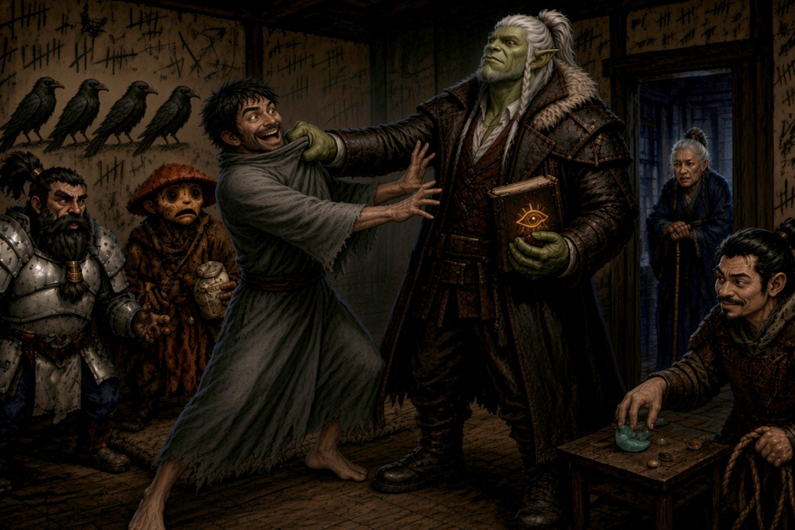

# Session Seventeen: Five Bells

**Date:** October 8, 2026

*Chapter 17. In which a dead scholar's journal turns up under a madman's mattress, the town Kurosawa called pliable votes against him to a hand, and a dwarf with no kin, no graves, no land, and no stake in Willowshore pronounces a verdict — and something, somewhere, answers it with five bells.*

*(Note: David was out; Gary ran Donkey. Chris's microphone was very low, so several of Boone's lines and rolls are missing from the transcript or attributed to other speakers. Where they conflict, the numbers below follow the GM's calls.)*

---

## Overview

The session picked up in the Yeshou suite where the last one froze. [Mido](../wiki/npcs/mido.md) answered the party's suspicion by showing them her son's room. It was bare, and every wall was scrawled in a dozen languages: *five must fall, not four*, the five archetypes, crows with a smiling human head, and **Cassian** written in the same frantic hand that defaced the cedar. When [Da Baishan](../wiki/pcs/da-baishan.md) moved the mattress, [Cheng](../wiki/npcs/the-smiling-one.md) launched himself onto the orc's back to stop him, and under the floorboards they found **[Cassian Voss's](../wiki/npcs/cassian-voss.md) field journal**. It carried the Palatine Eye's seal and was overwritten in Cheng's capitals. The journal describes a ruling house that adopts exactly five children per generation, a tapestry of five half-moth faces with one face replaced, a "shoreline" beneath Willowshore that opens onto a city called **Carcosa**, and a final entry: *"I am being followed... It walks behind me, matches my step, and smiles when I turn around."* The party pocketed it and told Mido nothing.

At [Willow's](../wiki/npcs/radiant-willow.md) festival, Littlefinger danced with [Meilin](../wiki/npcs/meilin.md) and set up her escape for tonight, and Boone danced with [Atsura](../wiki/npcs/atsura.md). An oni gate guard named [Ren](../wiki/npcs/ren.md) came forward with the fact that broke the case. The party then called their **Second Rite of Open Reckoning**: Boone as judge, the other four as accusers, Kurosawa as the accused. Kurosawa's own witness, [Captain Akoto](../wiki/npcs/captain-akoto.md), revealed that *he* was the one who reported the magistrate to the Mirror Tribunal. The town raised every hand. Boone nullified the conviction, and five unseen bells rang. A palm landed on his shoulder, and a pale moth flitted off it, leaving **mustard powder**. Atsura then stripped [Kurosawa](../wiki/npcs/magistrate-kurosawa.md) of his seat in the Magi. He answered with geomancy, *"A verdict is only as strong as the ground it stands on,"* sank into the earth, and left a **magnetic armored construct** in his place. Ginkgo commanded its armor off, Boone hacked it to pieces, and flies poured out of the wreck. **The party's names are cleared, Kurosawa is gone, and Atsura is staying.**

---

## Key Events

### Cheng's Room

Mido answered the party's line of questioning with a question of her own: *"You're 100% sure that Kurosawa did not do this?"* Littlefinger had the answer ready. Old Amber went silent two years before Kurosawa arrived, so *"I suspect Cheng and maybe you were involved."* Da Baishan added that the two styles of magic in this mystery are *"very, very different ones."*

- Mido, nervous, conceded the family's record. *"We have achieved some of our wealth by more gray-area means — smuggling and the like — a little light treason. But we are not a family of geomantic arcanists."* Cheng was *"scarred by the war"*; she knows what the town calls him, and how they avoid him. *"I'll show you something. And I'll preface it with this: I am still his mother."*
- She led them with her cane to the first door on the left: **Cheng's room**. *"Very few go in here. I'm his mother, and I don't go in very often."* He hears many voices, she said. He was always a linguist who picked up languages fast and loved ciphers as a boy, and she assumes that's why the army commissioned him for **code-breaking**
- Littlefinger ran **Trap Finder** on the doorway: clean. Inside, the room was barren. There was a water jug on a rickety table, a thin mattress on the floor, a ragged pillow, and a lantern. No shrine and no keepsakes. It smelled of ink, charcoal, and oil
- **The walls.** Writing covered everything in Elvish, Dwarvish, Common, and more, written upside down, in reverse, and over itself across years. There were **tally marks in fives** everywhere. The drawings were **four crows in silhouette and a fifth with a smiling human head**. The phrases that recurred:
    - ***ARTIST, RULER, SAGE, LOVER, JUDGE***
    - ***"FIVE MUST FALL. NOT FOUR, NOT FOUR, NOT FOUR"***
    - ***Cassian*** written clearly, with the surname scratched over
- **Littlefinger recognized the hand**: the same sprawling penmanship as the erased name on the third cedar at the [Hollow of Seven Cedars](../wiki/locations/hollow-of-seven-cedars.md), the "familiar" handwriting he couldn't place in Session Eleven
- Da Baishan's **That's Odd** caught it: Cheng had scampered straight to his mattress and sat cross-legged on it, *covering* something

### Treats, and a Tackle

- Ginkgo drew Cheng away with a bag of snacks bought in advance (*"Prescient planner"*). Cheng picked up charcoal, counted five tally marks on the wall without looking at anyone, then turned and said: *"Treat."* He got one
- Near the mattress, **the Palatine eye on Da Baishan's palm began to glow and warm**. He opened an investigation and pursued a lead on it, then lifted the mattress. Underneath were loose floorboards
- Cheng **tore across the room**. Boone and Ginkgo both grabbed for him (Reflex 13 and 13) and missed, and he flung himself onto Da Baishan's back, still smiling, clawing at his neck and eyes: *"Away — I want — you, mine!"*
- Da Baishan rolled **Athletics 28 (a critical)** and simply **lifted him off one-handed and held him up in the air**: *"Be calm."* Boone stayed out of it: *"He seems like he's handling it."*
- Littlefinger pulled rope from his pack and told Mido plainly that if she couldn't calm him, they'd have to restrain him for his own safety. She called to him (*"Son"*), and the rage drained out of his eyes, though the smile never moved. *"Dear son, we have some treats and some drink in the other room. Let them do their work."* She led him back to her suite. *"Please do return to me when you're done."*
- Braedon: *"Was he smiling the entire time he leapt at me to attack? That's creepy"*

### The Field Journal of Cassian Voss

Under the boards, hastily wrapped in tattered cloth, lay a small leather journal. On the inside cover was **the seal of the Order of the Palatine Eye**, the same eye as on Da Baishan's palm. *"Man, they keep scratching out his name. This poor guy."* It holds two hands: **Voss's entries**, and **Cheng's** capitals scrawled over and around them, sideways and in the margins. *(Full text on [Cassian Voss's page](../wiki/npcs/cassian-voss.md#the-field-journal-session-seventeen).)*

- **Arrival.** Five veins meet beneath Willowshore *"like spokes under a hub."* Old Amber, rice at the bridge rail. Willow warned him off the northern woods, so he went east along the river. Cheng, up the margin: ***THE LAKE IS UNDER THE RIVER***
- **The Battle of Five Crows** sits squarely on the **eastern vein**. Five companies held the ridge and four broke. The fifth stayed and **chanted** Chthonic letters *"carrying an older grammar."* None of them came home but one boy, *"and the boy came home smiling."* Voss's theory: it was *"a test of whether one could be done from a vein at all."* Cheng: ***FIVE CROWS / FOUR FLEW / FOUR FLEW / FOUR FLEW***
- **Tea with the ruling household**; *"the Elder serves it herself."* A tapestry shows Willowshore with **five faces at its corners, each half moth**, and **one face re-embroidered** with thread a generation newer. *"Someone has been replaced before."* The ancestral tablets bear no birth names. Every child is entered under one word, **RECEIVED**. *"The house adopts... Always five."* In a small, lucid hand in the margin: *"Are you sure you heard it correctly?"* (the exact words Cheng wrote for the party in Session Six)
- **Three pages cut out** with a clean blade. On the stub: *"...must be enacted, not merely..."*, ringed by **ARTIST RULER SAGE LOVER JUDGE**, with **SAGE** circled until the paper wore through
- **The shoreline.** Most convergences are wells; a few are *shorelines*, bordering *"a lake that lies beneath every lake,"* across which stands a city *"under two suns and black stars."* When the five veins open together, a living man could walk there from the town square. *"Only the hour, and an invitation. Its name is **Carcosa**."* Voss struck the name out: *"Names are how it finds you."* Cheng, huge: ***NOT A CITY / A MOUTH***
- **Seventh day**, the last entry: leaving for the cedars at dawn, where the eastern vein runs through a hollow. *"I am being followed. Not unkindly. It walks behind me, matches my step, and smiles when I turn around."* Below it, Cheng's scrawl repeats until the page is grey: ***ARE YOU SURE YOU HEARD IT CORRECTLY***. The remaining pages are blank
- **Da Baishan's Occultism (19) on Carcosa**: a name he's heard, rarely spoken. People call it a dream world or an alternate plane. *"I wouldn't call it someone's heaven, but a destination, or an origin, of some type of cult"* tied to an ancient religion. He can't yet place whose
- Braedon flagged the household entries: *"It sounds like it was describing Mido"*

### Leaving Mido in the Dark

- Littlefinger searched the room for anything of value (Perception 15 with Da Baishan's investigation bonus). There was nothing but crumbs and an oil lamp, and the journal is worth little as an object: *"a dead poet — more valuable dead than alive."* Braedon: *"We also discussed that you wanted to steal from the mentally challenged kid."* — *"Purely to assist the officer's investigation, sir"*
- **Littlefinger urged patience.** *"What if she's the head of this whole cult thing?"* Clear the party's names first, and if they confront the family, do it *"in front of everybody in the town... with the Magi behind us."* Ginkgo asked whether Mido deserved a chance to explain; the table decided they don't yet know how complicit she is. **Da Baishan carries the journal** (*"if I give it to Littlefinger, we may never see it again"*)
- Littlefinger told Mido they'd found nothing and were off to the festival. Her reply: *"I know what it implies — my son's room and his rantings — but I don't believe he has any malice. I don't think he's capable of planning something. I think all that you're seeing is a manifestation of what happened to him in that war."* And: *"This is our home. You know where to find us"*

### The Rumor Comes Home Drunk

Outside, lanterns were going up and rice was cooking, and Willow was prancing between decoration crews. An old man staggered up to Da Baishan reeking of drink. He'd come about **the reward**, which meant Da Baishan's Sow Rumor had landed.

- *"I saw him. The big one. In the woods. He drew a circle in blood. Summoned a demon. Fed it a goat, I think it was."* The woods were to the north, he said, deep and dark. Asked to lead them there, he revised it: it was **at the bridge**, really close, right here. He could go now
- Da Baishan played it perfectly straight: *"He drew a circle of blood on the bridge. In the middle of town. And he summoned a demon in the middle of town, in front of everybody."* — *"Don't forget, it was a goat."* He suggested the man draw a picture and take it to Atsura, *"she's got even deeper pockets than we do,"* and wrote in his investigation book: ***Possibly summoned a demon with a circle of goat's blood?***
- The testimony was **withheld from the trial**, wisely. Vic's verdict on the Sow Rumor: *"Not great. Not great"*

### The Festival: Matches Made

Kurosawa arrived with Atsura and [Masru](../wiki/npcs/mayor-masru.md). **Meilin** came on Masru's arm in a formal kimono, her face painted almost kabuki-white. She was plainly unhappy, and he steered her by the arm and corrected her posture and manners all night, *"like finishing school."*

- **Willow played her trump card**: *"I can make matches. I know people's hearts."* Ginkgo was exempt (*"I know you're in love with this whole town"*). Boone had been *"staring at this new magistrate like she's the last cask of ale in the bar... Why don't you ask her to dance?"* And for Littlefinger, *"Not very subtle. I've seen the looks you've given our former gravedigger."* Masru *"has yet to deny a pretty woman a dance,"* so Willow would ask him and buy Littlefinger one dance's worth of time
- **Littlefinger and Meilin** (Diplomacy 26). She glanced at Masru, saw him busy with Willow, and took his hand: *"Until he comes back."*
- **Boone and Atsura.** Kurosawa greeted him: *"Greetings, prisoner."* Boone said nothing to him and *"conveyed with his eyes that he's not worth talking to,"* then turned and held out his hands to Atsura. She accepted: *"I'm not a great dancer, but you've been very kind. If you don't mind me stepping on your feet a few times..."* Boone: *"Very strong feet."* The dance went well

### Meilin Says Yes

- *"Meilin, we need to get you out of the situation you're in. What do you think about getting out of here tonight?"* She leaned in: *"I'm pretty scared, but tonight might work. He tends to be sleepy and highly intoxicated during a festival. It might be my chance to get out. I don't know where to go if I was to leave."*
- **The plan**: Littlefinger will climb to her **second-floor window** at the estate tonight and rappel her down. They'll stop at Willow's for supplies and get her to a safehouse outside the city. *"Don't pack. Don't act like anything's different."* Da Baishan would get Masru drunk. Meilin: *"If there's a night to escape, the eve of Old Amber coming back and favoring Willowshore will be the night all the stars aligned. I will wait for you this evening."*
- Littlefinger: *"Thank Ginkgo — it was his idea."* (Under his breath, the rest.) After the session Vic admitted he'd engineered this. He'd been reading up on his **Monkey Pin**, climbing kit, and climbing aids, *"so I was really glad that you're like, second floor, open window"*
- **Da Baishan plied Masru with drink**, which wasn't hard. The mayor keeps his glass at least half full and drinks very fast

### A Soldier Who Doesn't Want the Money

Atsura found Da Baishan at the festival: she planned to cast her verdict **here, tonight, in the open**, *"while the omens and the spirits are smiling the greatest,"* but offered the party their Reckoning first. Before he could round up the others, an oni soldier spoke from behind him, careful not to be seen talking:

> *"I hear there's a reward, but I don't need any money. I stood on the river gate the night before the cataclysm happened. The magistrate walked through that gate. I reported it — but the log says he never entered that gate."*

- This was **[Ren](../wiki/npcs/ren.md)**, posted to the **east gate**, the river road toward the Gosembiki, where Littlefinger *"gently removed"* Kurosawa's device. Ginkgo: *"Are you willing to testify?"* — *"If that gets me an assignment out of here, I'm willing to testify. Willowshore is the most backward town I've ever been. I've lived in the city all my life."* (Vic: *"Pumpkins."* Gary supplied the banjo.)
- **The party's case**: Kurosawa's **verdict script** (via Masru), his **device-commission note**, the **cursed copper nails**, the **stolen ritual papers** with his diagram of the machine, Ren's testimony, and witnesses **Willow** and **Mido**. The drunk was withheld
- **Strategy**: Littlefinger floated accusing the Yeshou family of the second curse at the same time. Ginkgo and Da Baishan talked him down: *"If we're just casting all kinds of aspersions, people might not listen,"* and besides, *"Mido could also be a witness for us."* The family question stays private for now

### The Second Rite of Open Reckoning

The party raised their hands and called for the Rite. **Accused**: Kurosawa. **Judge**: Boone, the only one with no kin, no graves, no land, and no stake. **Accusers**: Donkey, Da Baishan, Ginkgo, and Littlefinger together.

- **The crowd was different.** The first trial's crowd was subdued and indifferent; this one was *in the party's corner*, animated and loud. Masru watched from the side, still eating and drinking. Atsura watched intently
- **Kurosawa**: *"It's a very interesting tactic. The former accused calling out their accuser — and they've been convicted. I think this might be setting a very new precedent. I'm interested to see what grounds and evidence you can fabricate to support this claim."* Da Baishan: *"Well, unlike some people, we don't have to fabricate evidence"*
- **Willow** testified to what they'd done for the town, and then turned to the crowd. At the first trial she was the only one to raise her hand, *and she knows why*. She felt what they felt, the minds caught and dulled, and that was Kurosawa's doing at the Cedars. *"Now that you're thinking freely, trust your heart. And if you want to raise hands with me and with this group today, do it of your own will."* The square came alive
- **Mido** lacked Willow's warmth but was precise. She described meeting the party outside town, the Seven Cedars, and the evidence, and her family's standing carried real weight. **Masru** testified to the coercion that brought him to Willowshore
- As the documents went round, the crowd muttered: *"I can't believe he did this... how is he going to get out of that?"*

### Kurosawa's Defense

- **On the script.** To Masru: *"I saw you burn a parchment that evening."* Masru, swaying and drunk, rolled a coin across his knuckles and made it vanish and reappear: *"You saw me burn a parchment? You learn a few things running a casino for all those years. I thought I might need this at some point for my own survival."* Kurosawa turned it around: a man that skilled at palming papers *"surely has the ability to write in someone else's hand. Perhaps it was written this morning, or an hour before this trial."* A self-confessed practitioner of skullduggery can't be trusted
- **On the dead.** He called [Luda](../wiki/npcs/luda.md) about the tonic she sold the party: it puts a person in a deep slumber, *near death*, if properly applied. *"This is the second time this group has conferred with the dead. Now they align themselves with the dead again to bring up new evidence"*
- **On procedure.** He called his last witness, Captain Akoto: *"Enough with the theater and coins and tearful testimonies and empathetic pleas from folks like Willow. We're not here to be entertained. This is a court... What we need is clear jurisprudence."* Was every arrest in this district made under written warrant? *Yes, Magistrate.* Countersigned by a second officer? *Yes.* Chain of custody recorded? *Yes.* And in all your years under my command, was any irregularity ever reported?

> A long pause. *"Yes, Magistrate. One."*

- For the first time, Kurosawa fumbled for words. *"Reported by whom?"*
- Akoto: he filed it himself, **to the Mirror Tribunal under the oversight provision**, as the law and procedure require. The log Kurosawa entered in the estate records the night before the cataclysm **didn't match one of his officers' reports**. *"So I filed it and sent it to investigate. That's why they're here. You weren't where you said you were. I didn't think I would be forced to answer that question, especially by you. But it was the proper procedure to follow. And I followed it."*
- Kurosawa recovered: *"This good officer has followed the provisions correctly, and I commend him. It's precisely what I trained him to do."* One paperwork discrepancy. No procedure bypassed, no corners cut. *"Everything else is a clean bill of innocence"*
- **Willow**: *"If you support Da Baishan and the accusers, raise your hand."* She raised hers first, and **the entire crowd followed**. Kurosawa turned to the dwarf: *"Well then, Judge Boone, I guess this is in your court now. What is your verdict?"*

### The Verdict

> *"I've heard enough, and I believe the town has heard enough as well. In the name of Old Amber, whose spirit looks over us all, I rule that the evidence is clear: the first Rite — Kurosawa's Rite — was tainted. He falsely accused this group and corrupted the outcome. The breaking of the land and the shadow on this town come from him. The conviction is nullified. Kurosawa must pay reparations to this town for the damage he caused, and then bother the town no more. His fate is to be decided by the magistrates."*

He looked at Atsura. And as he spoke the last line:

- **Five bells rang** in the distance. Nobody remembers putting up bells
- Something like **a palm landed on Boone's shoulder**, *very forcefully*. No one else saw or felt anything
- When he looked, **a small pale moth fluttered away**, leaving a residue on his shoulder the color of **mustard**

### Atsura's Verdict

> *"By the authority of the Council of the Magi and the Mirror Tribunal, I strip Kurosawa of his seat in the Order of the Magi. His commission is void, his workings disavowed. He is ordered to return for correction. Until he does, he acts for no one. He speaks on behalf of himself alone. He has no ties to the Magi or any order. From this moment forth, that is my verdict."*

- Kurosawa unslung his **nodachi**, not threateningly, and held it in both hands as if to surrender it. As she came to take it, the party (everyone keyed in, with high Perception rolls) caught what he said under his breath: *"You've been taught well. You've obeyed every policy and procedure."* Atsura: *"I've done as I've been ordered to do. There's no joy in this sentence. It is the right verdict."*
- Then he turned to Boone: ***"A verdict is only as strong as the ground it stands on."*** He knelt and etched **geometric lines** around himself with the sword's tip. The earth wrapped up around him, and **where he'd been stood something else**. Vic: *"The old switcheroo."* Braedon: *"We accepted our verdict and banishment with good class."* — *"Did the crime, did our time"*

### The Magnetic Construct

A huge armored soldier of geometric plates with a glowing head suspended where a head should be, wielding a heavy metal rod. A **magnetic field** surrounded it for several feet: anyone in metal armor or carrying a metal weapon moved away from it as if through difficult terrain. (Da Baishan: *"Is this where my studded leather armor is going to come in handy?"*)

Initiative: Littlefinger 22, Ginkgo 21, Boone 17, Da Baishan 9 (Donkey somewhere between; Atsura rolled badly).

- **Littlefinger** slid back, hid, and slung a stone (21). It **clanked off the armor**
- **Arcana** (Donkey and Da Baishan, 22): the construct's plate is held by magnetism and makes its AC very high. Deal enough damage to break through its hardness and **the armor shatters** and its AC drops
- **Ginkgo** checked for void healing (no, as far as anyone knows; it's a construct, and would have to be re-summoned to heal), then cast **Command: "Drop your armor."** It **failed** (18 vs. DC 20). The magnetism shuddered and the great chest plate and guards **thudded to the ground**. *"It is now a lesser armored soldier."* (Braedon: *"You just tell it to strip."*)
- **Boone**: 14 (miss), **24 for 18**, 4 (*"You got tired"*)
- **The construct** tried to **magnetically rip Boone's blade from his hands**. He resisted with Athletics 23 and *"all of your dwarven might."* Its club swings (17, 14) both missed
- **Donkey** (Gary at the wheel): **Ignition for 7 fire**, then backed off
- **Da Baishan**: Divine Lance missed (9). Then the **guandao** at reach, **24 for 14**
- **Littlefinger**: three sling hits for small damage. A table rules dive followed: in PF2e, sneak attack applies to *every* qualifying strike against an off-guard target, not just the first. But this construct is **immune to precision damage**, so none of it counted. *"It doesn't have a heart or vein or anything like that"*
- **Atsura** joined in with her **wakizashi for 12**, and one of her arm tattoos glowed into a **golden shield**
- **Ginkgo**: **Divine Lance, 23, 7 damage**
- **Boone**: **24 for 13**. The field weakened; hair stood on end, but the pull was gone
- The construct unleashed a **magnetic jolt** (Fortitude, 15 ft). Everyone cleared 17 except Donkey (11), who took **30 and collapsed, dying**. Then the table realized **Boone still had two attacks left**. The GM rewound it and gave Boone a premonition: kill it now, or the blast kills Donkey. Vic: *"No pressure, but Donkey's gonna die if you don't kill it"*
- **Boone: 15 for 17, 20 for 15.** His strikes split the central housing; metal screeched, and the construct dropped. **The jolt never happened.** Out of the holes poured **flies, locusts, and gnats**, streaming past the party until none were left. Only torn plate and a metal rod remained in the dirt. Boone's night: **63 damage** across four hits

### After the Festival

- The crowd scattered when the construct appeared and crept back out after. Willow ran to the party clapping: *"Our village heroes did it again!"* She grabbed the nearest one, **Ginkgo**, and hugged him
- **Masru** toasted the party repeatedly, held a drinking contest, put away a great deal of sake, and needed two oni guards to get him back to the estate. **Meilin followed close behind** under the full moon
- **Mido and the Yeshou** left early. With Kurosawa gone, they may get their estate back soon
- **Atsura**, to Da Baishan and Boone: her commission here is over, but she has **petitioned to stay longer** and will live at the **Silver Mist Inn** as a resident until the Mirror Tribunal answers. On Kurosawa: *"I know him well. He's always been bound by law, every rule. He was a follower — that was part of his sense of pride for as long as I knew him. And now, without that rule of law to bind him, I'm not sure what he'll do. I'll provide whatever assistance I can if he does come back."* She has no authority now, only her skills, offered *"as a resident and a friend"*
- Da Baishan raised the second curse. Atsura: *"That's become abundantly clear as I've investigated. Our good long friend Kurosawa would also seem to have stumbled upon that, and looking at the research that he has provided may give us some other insights."* Her deepest knowledge, she says, is of the Magi, and of Kurosawa himself
- Boone: *"Great work today, Atsura."* Then a **fist bump**, which she returned. The party went back to their rooms at the Silver Mist Inn

### Level Four Housekeeping

- **Littlefinger** took **Poison Weapon**: each morning he prepares simple injury poisons equal to his level (1d4 poison, no save), for his sling stones. He also took **Tattoo Artist**: formulas for four common magical tattoos of level 2 or lower. Atsura has arcane tattoos and *"maybe she could teach you."* Vic declined to step on Boone's toes. Boone: *"You got to rescue your Meilin"*
- Afterward Vic shared his Alaska cruise photos: salmon runs, six bears, a glacier helicopter ride (despite his fear of heights), Hubbard Glacier, and a Denali grizzly strolling past the bus

---

## Memorable Moments

- **"Treat."** Cheng, counting exactly five tally marks on the wall without looking at anyone, then turning to Ginkgo for payment
- **The one-handed hold.** Da Baishan answered a smiling man clawing at his eyes with a critical 28 and held him in the air like a cat: *"Be calm"*
- **"At least it's not a Playboy."** Braedon, on what turned out to be under the madman's floorboards
- **"Purely to assist the officer's investigation, sir"** — Littlefinger, searching the room of a war-damaged man for valuables
- **"Don't forget, it was a goat."** The Sow Rumor's first witness, whose demon-summoning moved from the deep northern woods to the town bridge in about ten seconds
- **"Like the last cask of ale in the bar."** Willow on how Boone looks at Atsura
- **"Greetings, prisoner."** Boone said nothing back, conveyed with his eyes that Kurosawa wasn't worth talking to, and asked the magistrate's boss to dance instead. *"Very strong feet"*
- **The coin trick.** A drunk ex-casino boss showing a seven-foot oni how he kept the parchment he was seen burning
- **"Yes, Magistrate. One."** Kurosawa's own witness, trained by Kurosawa to follow procedure, followed it
- **The whole square raises its hands.** At the first Reckoning, Willow raised hers alone
- **Five bells and a moth.** The verdict lands, and something no one else can see puts its hand on the judge
- **"Did the crime, did our time."** The party on having taken *their* conviction with good grace
- **"You just tell it to strip."** Ginkgo's Command takes a construct's armor off in one word, more or less
- **"No pressure, but Donkey's gonna die if you don't kill it."** Boone, given a premonition and two attacks, hit with both
- **The fist bump.** Boone and Atsura, after a trial, a verdict, and a construct

---

## Discoveries

### Lore Learned

- **Cassian Voss's field journal** was hidden under Cheng's floorboards, sealed with the Palatine Eye and overwritten in Cheng's hand. Its last entry describes **being followed by something that "walks behind me, matches my step, and smiles when I turn around"**, which is exactly how Cheng walked behind Da Baishan in Session Sixteen. Read against the [Book of Divided Testimony's](../wiki/locations/palatine-eye-vault.md#the-book-of-divided-testimony) line about Mido (*"she knows what followed the last traveler home"*), Voss now looks very much like the last traveler
- **Cheng wrote over the journal, and Cheng scratched out the name.** The handwriting on his walls matches the erased carving on the third cedar
- **The Battle of Five Crows was on the eastern vein.** Five companies; four broke (*"four flew"*); the fifth stayed and chanted Chthonic in *"an older grammar."* One boy came home smiling. Voss's theory: a test of summoning *from a vein*. Cheng's walls: *"five must fall, not four."* The implication is that the battle failed because only four fell
- **The Yeshou house "receives" exactly five children per generation.** No birth names; every tablet says RECEIVED. The receiving-room tapestry shows **five half-moth faces**, one re-embroidered a generation later: *"Someone has been replaced before"*
- **The five archetypes "must be enacted, not merely..."** The rest was cut out with a blade. SAGE was circled until the paper tore. **Boone has now publicly enacted JUDGE**: he pronounced a verdict under the old law, five bells rang, an unseen palm struck his shoulder, and a pale moth left mustard powder behind
- **Willowshore is a "shoreline,"** a convergence bordering *"a lake beneath every lake,"* across which lies **Carcosa** (*"two suns and black stars"*). When all five veins open together, a living person can walk there from the square with *"only the hour, and an invitation."* Cheng's correction: *"NOT A CITY. A MOUTH."* Da Baishan knows Carcosa as the destination or origin of an ancient cult
- **Kurosawa entered through the east gate** the night before the cataclysm, and the estate log says he didn't. Ren reported it. Captain Akoto filed the discrepancy with the Mirror Tribunal, and that filing is **why Atsura came to Willowshore**
- **Kurosawa can sink into the earth and leave a construct behind.** The construct was a magnetic, plate-armored geometric soldier, immune to precision damage and full of **flies, locusts, and gnats**
- **Kurosawa may have trained Atsura**: *"You've been taught well."* She says she knows him well, that he was always a follower bound by law, and that without law she doesn't know what he'll do

!!! note "Out-of-game aside"
    Readers of Robert W. Chambers (and of Pathfinder's Great Old Ones) will know *Carcosa*: a city of twin suns and black stars, and the seat of **Hastur, the King in Yellow**, also called **the Unspeakable One**. Voss's spirit used that last title in Session Six (*"the ritual for the Unspeakable One. Five must be sacrificed to bring —"*), and the campaign's recurring residue is **mustard-yellow**. Nothing in-game has tied these together yet.

### Items and Resources

| Item | Holder | Detail |
|---|---|---|
| **Cassian Voss's field journal** | Da Baishan | Palatine Eye seal; Voss's entries overwritten by Cheng; three pages cut out; remaining pages blank. The party has **not** told Mido they have it |
| **Kurosawa's verdict script, device-commission note, stolen ritual papers, cursed copper nails** | Party | Presented at the Second Rite; Masru claims Kurosawa saw him burn the script |
| **Mustard residue** | Boone's shoulder | Left by the pale moth that took off from him after the verdict |
| **Construct wreckage** | Town square | Torn magnetic plates and a heavy metal rod; the swarm inside is gone |
| **~32 gold** | Littlefinger | Still unspent |

### Character Notes

- **Boone** sat as **judge** in the Second Rite, nullified the party's conviction, sentenced Kurosawa to reparations and exile, and **was touched by something** as he did it. He also danced with Atsura, killed the construct (63 damage on the night), and ended it with a fist bump
- **Da Baishan**: his Palatine eye **glowed near the hidden journal**, his critical Athletics held Cheng off, his Occultism placed Carcosa, and he carries the journal. His Sow Rumor produced one useless witness, but it may also have brought out Ren
- **Ginkgo** distracted Cheng with treats he'd bought in advance, got credit (from Littlefinger) for the Meilin plan, stripped the construct's armor with **Command**, and was hugged first by Willow again. Willow has declared him unmatchable: he loves the whole town
- **Littlefinger** recognized the cedar handwriting on Cheng's walls, danced with Meilin (Diplomacy 26), and is climbing to her window tonight. He took **Poison Weapon** and **Tattoo Artist** at level 4
- **Donkey** (run by the GM) contributed Arcana and an Ignition, and was briefly dying until a rewind removed the blast that downed him

---

## Open Threads

### Active Mysteries

- **What followed Voss home?** His last entry: something that walked behind him, matched his step, and smiled. Cheng does exactly that. Is Cheng the *thing*, or the *door* it keeps (*"keep a door for itself, and smile from behind it"*), or both?
- **Who cut out the three pages, and what did they say?** *"...must be enacted, not merely..."* The cut was clean and close to the spine, the work of someone careful. That doesn't sound like Cheng
- **Is Boone now marked?** JUDGE was enacted publicly, and something answered with five bells, a palm, and a moth. If the five archetypes must be *enacted*, who holds the other four? The table has candidates: **SAGE** (Voss, the scholar, circled until the paper tore), **ARTIST** and **LOVER** (Willow? Meilin?), and **RULER** (Masru? Mido?)
- **Why always five Yeshou children, and why adopted?** Who is the re-embroidered face on the tapestry, and who is *"received"* this generation? Is Littlefinger's tie to *"Grandmother"* Mido one of these adoptions?
- **"Five must fall. Not four."** Did the Battle of Five Crows fail because only four companies fell? What does a fifth falling complete?
- **Carcosa.** A *mouth*, not a city, reachable from Willowshore's square when all five veins open, *"with only the hour, and an invitation."* Kurosawa was trying to force all five veins into accord. Was he unknowingly opening the door for someone else?
- **Where is Kurosawa?** He was stripped of rank, ordered back *"for correction,"* and bound by no law now. Atsura doesn't know what he'll do. He left a construct and a parting line for Boone
- **Kurosawa's research on the second curse.** Atsura says he *"stumbled upon"* it and that his research may help. Where are those papers now?
- **"5,000 gold pieces"** (Atsura, Session Sixteen) is still unexplained

### Promises and Debts

- **Meilin's escape, tonight.** Littlefinger climbs to her second-floor window at the estate while Masru sleeps off the sake. The route runs via Willow's for supplies to a safehouse outside town, and that safehouse doesn't exist yet. *"I will wait for you this evening"*
- **Ren** testified on the promise of *"an assignment out of here."* Someone should put in a word
- **Kurosawa owes reparations** to the town, per Boone's verdict. Good luck collecting
- **The drunk** thinks he's owed a reward. He has gone to Atsura with his picture of a goat
- **Littlefinger's tattoo formulas**: Atsura might teach him

### Next Steps

1. **Rescue Meilin** tonight. Find her a safehouse first (Willow? Mido's tunnels? Atsura?)
2. **Read the journal closely** and decide when, and whether, to put it in front of Mido
3. **Talk to Atsura** about Kurosawa's research into the second curse, and about the Tribunal's next move
4. **The Yeshou estate** may be returned to the family now that Kurosawa is gone. The tapestry and the RECEIVED tablets would be inside
5. **Watch Boone**, and the mustard on his shoulder

---

## Timeline

| Time | Event |
|---|---|
| Day 5, late afternoon | Silver Mist Inn: Mido's *"light treason"*; **Cheng's room**; Cheng tackles Da Baishan; **Voss's field journal** found under the floorboards |
| Day 5, late afternoon | Party withholds the journal from Mido; heads out for the festival; the Sow Rumor's drunk witness and his goat |
| Day 5, ~7 PM | **Festival** begins: Kurosawa, Atsura, Masru, and a painted Meilin arrive; Willow's matchmaking; **Littlefinger dances with Meilin** and plans her escape; **Boone dances with Atsura** |
| Day 5, evening | Da Baishan gets Masru drunk; Atsura announces a verdict tonight; **Ren** comes forward about the east gate |
| Day 5, evening | **The Second Rite of Open Reckoning**: Willow's and Mido's testimony; Kurosawa's defense; **Captain Akoto's "Yes, Magistrate. One"**; every hand in the square raised |
| Day 5, evening | **Boone's verdict**: conviction nullified. **Five bells; the palm; the moth.** Atsura strips Kurosawa of his seat |
| Day 5, evening | Kurosawa sinks into the earth; **the magnetic construct** is destroyed by Boone; flies pour out |
| Day 5, night (full moon) | Masru carried home drunk, Meilin behind him; Atsura will stay at the Silver Mist Inn; fist bump; party retires. **Session ends** |
| Day 5, late night (upcoming) | Littlefinger climbs to Meilin's window |

---

## The Scene

### Be Calm

The room smelled of lamp oil and charcoal and old ink, and the walls were written over so many times that the plaster had gone grey. Crows marched in fours, and every fifth one had a man's head, grinning. Tally marks stood in fives in every corner, counted and recounted. Over by the far wall, Ginkgo was rattling a little bag of rice cakes, and Cheng had followed it like a dog follows a hand. He made five charcoal strokes on the plaster without looking up, then turned for his reward. Mido waited in the doorway with both hands on her cane and didn't come in. That left Da Baishan alone with the mattress Cheng had been sitting on. Halfway to it, the eye on his palm began to warm, and then to burn, the way it had at the cliff and the poisoned pool. He knelt, hooked his fingers under the thin pallet, and lifted it. The floorboards beneath sat loose in their seats, as if they had been pried up and pressed back down a hundred times.

He never heard Cheng cross the room. Boone's hand closed on a sleeve and came away empty, and Ginkgo grabbed nothing at all. Then something hit Da Baishan between the shoulders, light and all elbows, and wrapped around his neck. Fingers dug at his collar and raked up toward his eyes, blunt but determined, the way a cat goes for a face. The breath at his ear was hot and fast. *"Away — I want — you, mine!"* The words were frantic, but when the orc twisted to look, the face pressed against his shoulder was smiling the same wide, happy smile it had worn at the table, and in the street, and on the walk back to the inn.

Da Baishan reached back with one arm, found a fistful of robe, and pulled. Cheng came off him easily; he couldn't have weighed more than a sack of rice. The orc stood and held him out at arm's length, feet clear of the floor, arms still windmilling toward a face they couldn't reach. *"Be calm,"* Da Baishan said. He said it slowly, the way you talk to a horse in a burning barn. Behind him Littlefinger was already uncoiling rope and saying something low and reasonable toward the door, and the matriarch answered with one word: *"Son."* The thrashing stopped as if a string had been cut. The fury left Cheng's eyes, and his shoulders dropped, meek as a child's. The smile didn't change. Da Baishan set him down, and Cheng padded to his mother's side for the promised treats without looking back at the loose boards. The eye in the orc's palm was still burning.
