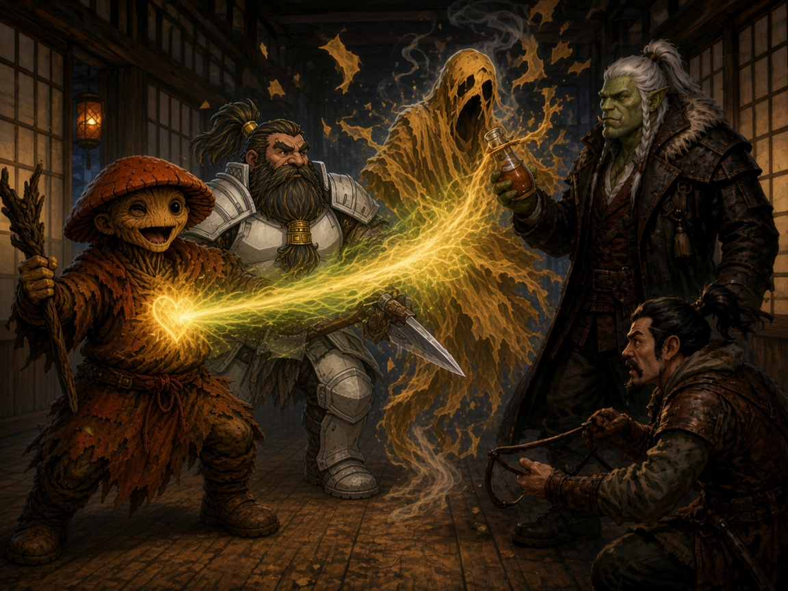

# Session Eighteen: Marks for the King

**Date:** October 15, 2026

*Chapter 18. In which a magistrate and an orc compare ink on a moonlit bridge while a dwarf checks the rear for guards a suspicious number of times, a disgraced oni shows a halfling his own moth-mark and walks out a window, a gravekeeper escapes with a small satchel she was told not to pack, and something tall and tattered drinks a judge's plum wine and reaches for his soul.*

*(Note: David was out; Gary ran Donkey. The recording dropped for about six minutes in the middle of Atsura and Da Baishan's conversation on the bridge. That gap is covered below as the rest of the party saw it, not as the GM ran it.)*

---

## Overview

The festival wound down under a full moon. [Atsura](../wiki/npcs/atsura.md) stopped the party on the bridge and asked for Da Baishan alone. She told him off for borrowing the Magi's name for his rumor, then asked to see his Palatine eye, and the two of them spent a long while comparing tattoos. Meanwhile Littlefinger climbed to the second floor of the Yeshou estate to rescue [Meilin](../wiki/npcs/meilin.md) and found **[Kurosawa](../wiki/npcs/magistrate-kurosawa.md)** in the dark study, packing his research. Kurosawa showed him a **mustard moth-mark** on his neck, the same mark as Boone's, from the fifth bell. *"I'll be one of five to have this."* He advised them to look at the Yeshou family, then left through the window for the northern woods. Littlefinger got Meilin out past the snoring [Masru](../wiki/npcs/mayor-masru.md) and hid her at [Willow's](../wiki/npcs/radiant-willow.md). When Willow hugged Ginkgo goodnight, he saw **the same mark on her neck**.

That night Boone dreamed of a flat, unmoving lake under **two suns**, a city of towers, and **a judge's chair with a mustard cushion, exactly his size**. He woke to an empty plum-wine jug and **a tall, tattered, mustard-robed spirit** standing over him. The party fought it in the inn's hallway. Ginkgo's **Vitality Lash** tore it open, and Da Baishan finished it by throwing a **healing potion** at it. Littlefinger said what everyone was thinking: *"They didn't send him to kill us. They sent him to kill the Judge."* They ran to Willow's. Da Baishan failed to break down her door twice, and then she opened it. She'd had the same dream and **painted it in her sleep**. By morning Masru was shouting that Littlefinger had stolen Meilin, and [Yong](../wiki/npcs/yong.md) was begging for help with his son. Boone and Donkey slipped a disguised Meilin out of town. The rest found **[Hong](../wiki/npcs/hong.md)** in his cot with the mark on him, raving about two suns and a chair: *"It's coming for me. I know it's coming for me."*

---

## Key Events

### On the Bridge

The town was nearly empty. Masru was being half-carried back to the estate by oni guards, [Ren](../wiki/npcs/ren.md) among them, with Meilin in tow. Littlefinger used **Shadow Mark** to follow them, and Ginkgo, Boone, and Da Baishan trailed behind for backup. Donkey went back to the Silver Mist Inn. On the little arched bridge over the main river, Atsura met them coming the other way: *"I know it's a late hour and I'm not gonna ask where you guys are headed at this point, but may I have a word with Da Baishan?"* He let the others go on: *"I'll catch up."*

- **The goat.** *"A man came to me tonight with... a goat story, and wanted a reward. The Magi have offered no reward. Would you put the council's name on a falsehood? But it was clever, I guess. It did uncover Ren, and that testimony did help us with the case. I'm not blind to that. But a case with lies is a case with cracks in it. And someone like Kurosawa, who I know well, spends his life looking for cracks like these. Next time, if you want to use my authority, ask me first. I may even say yes."*
- Da Baishan apologized. He couldn't make heads or tails of the man's account and had hoped her insight could judge it. *"My apologies if it was a wild goat chase, if you will."* She'd given the drunk *"a couple gold coins and a little bit of a smile. It was quite a tale"*
- **The mark.** Watching the river in the moonlight, she asked: *"May I see it? The Order's mark."* — *"Happily. I'm not a man of secrets. I only request, if you know anything of the Palatine Order, please share. I'm on a journey of self-discovery."* She was out of her Tribunal uniform, in something more relaxed with shorter sleeves, so her tattoos showed. She took his hand and traced the outline of the eye gently, *holding on maybe a little longer than she needed to*
- **On the Order**: *"I've always respected the Order. I like what they stood for. The search for secrets and truth. And from what the stories are, it didn't matter what creed, what race, or what background someone had. If you were called, you were called. And I like that they marked."* Then: *"Did you do it yourself?"* — *"I wish I had the skill that you have for tattooing. No. It was bestowed upon me through a mechanism I cannot understand. I merely accepted the calling"*
- **On her own ink.** *"A true magical tattoo. Mine obviously is ink, or arcane."* She's had to hide them. Among her people, *"a needle is not something you would take to skin we're supposedly born finished. Why would you put graffiti on a temple? It was a blemish."* Her **father** found the first, a **crane's head** on her back by the shoulder blade, when she was **nineteen**. *"He didn't shout. He lectured. He always lectures. Several hours of lectures telling me all the precedents of the oni, dark things that happened to them."* She turned over her wrist to show a **butterfly**: *"I got that one the day after he chastised me"*
- Da Baishan: orcs aren't much for self-ornamentation either, so tattooing is unfamiliar to him. *"However, I do admire your tattoos. I am slightly jealous of the abilities they give you."* She showed him more, including the **shield** from the construct fight, and mentioned *patterns you can discover and create yourself*

### Meanwhile, at the Far End of the Bridge

!!! warning "Lost audio (about 22:40 to 28:27)"
    The recording cut out here. Nobody knows what Atsura and Da Baishan said for these six minutes. What follows is what the rest of the party could see from the north end of the bridge, in moonlight, with no sound. Treat it as the table's account, not the GM's.

Boone took up his post outside the estate wall, where he could hear if Littlefinger yelled. He chose the corner with the best view back down the road to the bridge, in case of guards. He checked for guards. A minute later he moved a few steps to check again, and then a third time, each time from a spot with a slightly better view of the bridge. Ginkgo had his **Message** link open to Littlefinger, so he ended up narrating to him in whispers. The magistrate had rolled up a sleeve. Da Baishan had rolled up a sleeve. The magistrate had rolled up her *other* sleeve. Da Baishan had nothing left to roll up, and was holding out his one palm like a man laying down a single playing card against a full hand. From inside the estate grounds, Littlefinger's reply came back: *"Focus."*

What they could make out in silhouette: Atsura pointing at her shoulder blade, then her wrist, then a spot on her forearm that briefly **glowed gold**, which was plainly showing off. Da Baishan gave what looked like a long, thorough lecture on his single tattoo, and at one point pulled his collar aside, apparently to prove he had no others. Ginkgo reported that she laughed. Boone, still watching for guards, said that was nice, and added that dwarves have been carving runes into things for a very long time, actually, if anyone was interested in that kind of thing. Nobody had asked. A little later he asked Ginkgo, purely hypothetically, whether a cleric of the fungal persuasion knew how long ink takes to heal on a dwarf.

When the audio comes back, Atsura is finishing a thought: *"...different background than the rest. And I appreciate the early trust that I've earned. Not sure I'm deserving of it, but I appreciate it."* She **touched his forearm** and walked off south. Up the road, Boone found that the estate fence suddenly needed his full attention. Braedon's verdict on the whole encounter was that he'd survived it **without incurring the wrath of Boone**.

### Kurosawa in the Study

- Littlefinger slipped onto the estate grounds behind Masru's party (Stealth 28, +2 for the shadows). Boone and Ginkgo lost track of him completely: *"like he morphed in with the shadows."* Boone stayed outside the walls within earshot (*"My plan is to not mess up the stealth"*), and Ginkgo kept his **Message** link open
- A light went on in the **master bedroom**, which takes up the whole west wing of the second floor. The blinds closed, and about ten minutes later it went dark. The room next to it is the **second-floor study**, the one Donkey first searched and Kurosawa used as his research room. Its window was **still open**
- Littlefinger activated his **Leaf Shadow Clasp** (no tracks, +1 to Sneak) and **Monkey Pin** (+1 to climb), threw his grappling hook into the open window, and climbed (Athletics 21). Near the sill he heard **something move inside**. He pulled himself up just far enough to look (Stealth 20). With halfling darkvision he saw a figure at the desk **stuffing papers and books into a satchel**. It turned toward him with **glowing red eyes**: *"You're very quiet."* It was **Kurosawa**. (Gary: *"This guy just won't die."*)
- Littlefinger considered sliding back down the rope, then climbed into the room instead. *"Kurosawa, what are you taking? What are you doing, man? You heading out of town?"* — *"I'm taking what is owed to me. This is my research."* — *"We've been at odds, but we don't have to continue to be. I'm not here for you. I'm here to save a different life. If you'll go your way, I'll go mine"*
- Kurosawa reached for his sword, which was leaning on the wall, but didn't draw it. *"Young Littlefinger, I agree we may not be friends, but I don't believe we're enemies anymore. Truly. You have come to realize that there's more going on here than the game that you and I have been playing."* (Vic: *"Absolutely. And I was gonna scream like a girl."*)
- **The mark.** He snapped a small flame alight, pulled back his collar, and showed **moth dust at the crook of his neck**. Then he put the flame out quickly:

> *"This mark happened this evening, and I believe it's the same one. A moth landed on me and gave me this mark, and it does not come off. There's a dire plan, and I need to find out what it is. I started researching it a bit, but now I'm going to dedicate everything I can to understanding what I've been roped into. I heard five bells when your judge sentenced me in that Rite of Reckoning, and this moth landed on me at that time, on the fifth bell. I don't believe that was a coincidence. Five has been a very recurring number. The Yeshou family had five generations. There are five ley lines here. We're in the fifth month of the year. This is not a coincidence. And I believe this mark — I'll be one of five to have this."*

- He took things from the desk and from the chest at the foot of the bed, slung the satchel over his shoulder, and picked up his sheathed sword. At the window he left a parting tip: *"I don't believe you're foolish enough to attack me on your own, but good luck in your investigations. I think if I were those remaining here in Willowshore, the Yeshou family is the one I would look toward first. Who else could have orchestrated us all being there at the same time?"* He jumped, landed deftly, and went **north**, over the outer wall and into the woods
- Littlefinger had already whispered to Ginkgo, *"I got it, I got it. Stand down."* No one got in Kurosawa's way

### Meilin Walks Out

- Littlefinger took a few seconds to get his heart rate under control, then checked for traps (Perception 26). He found none, just drawers left askew and the books Kurosawa didn't want. The master bedroom's double doors were **unlocked**. From inside came *"the snoring sound of someone very large"* (*"Someone with some sleep apnea issues"*)
- Masru was sprawled half off the bed, as if he'd been dropped there and passed out on the way down. **Meilin was in the corner.** She startled, then whispered: ***"You came."*** She had a small satchel: *"I know he said not to pack anything, but I only grabbed a few things. He didn't seem to notice at all."* (Vic: *"Exactly. That's exactly how this is going down."*)
- *"Follow me and don't make a sound."* They went back through the study and down the rope. Meilin climbed well (grave-digging builds the upper body, the table agreed). Then they went over the fence (Stealth 26) and headed south, with the doors left ajar behind them
- **Where to?** Not the inn, and nowhere else in town. Littlefinger chose **Willow's back rooms**: *"I figure that's where Ginkgo probably wants to go most anyway"*

### Willow's Goodnight

- Willow hurried them in and hugged Meilin, who was excited and nervous in equal measure (*"How long am I gonna stay?"*). Willow set up a room in the back: *"We'll probably have to move you again at some point, but you can rest here. Hopefully your dreams will be quiet, with hope at the end of them"*
- Then, to the party: she couldn't thank them enough for what they'd done for the town and for its people. *"Inspiring is the first word that comes to mind. I believe Willowshore will bloom because of what you've done these past few weeks."* She hugged each of them firmly, **Ginkgo last, longest, and hardest**, and turned away: *"May you all have dreams of heroes"*
- **Ginkgo (Perception 29)**: as she turned, he saw **mustard-yellow moth wings on the side of her neck**. He said nothing

### Plum Wine and a Roll Call

- The town was dark and quiet under an almost-full moon. At the Silver Mist Inn, **a jug of plum wine** sat outside each of their doors, with a tag in ordinary handwriting: ***Thank you.***
- Ginkgo told the others what he'd seen on Willow. They pieced together the marks. **Boone is JUDGE** (*"you're the judge because you've got the poop on you"*). Littlefinger proposed **Kurosawa as RULER**, and **SAGE** might be **Cassian Voss** (Boone pointed out SAGE was circled until the paper wore through). Ginkgo thought all five were marked at the same moment, and he also remembered the line *"Five must be sacrificed to bring—"*. Da Baishan: *"It doesn't sound great for Boone"*
- Asked whether he'd been hearing any voices lately, Boone said, *"More than usual."* Ginkgo didn't want to worry Willow with the mark yet. Da Baishan opened a new investigation into *"the five roles, five actors, five... five somethings."* His quick identification can say what kind of magic a mark is, but *"it's not like a divining rod"* for finding the others
- Littlefinger wanted to sleep hidden at Willow's. The others were fine with the inn (*"I don't feel terribly unsafe at the inn"*). They took their plum wine in and went to bed

### Boone's Dream

> The water is flat. It goes on forever. When the wind blows it doesn't move; it's like something solid. Above it hang **two suns**, low on the horizon and a little askew: **one red, one mustard**. The sky is dark, and the stars are darker. Instead of giving off light, they seem to swallow it. Far across the motionless water stands **a city of towers**, nothing like any city he's seen. It isn't elaborate or opulent at all. It's stark, strong, and dire. At the edge of the water sits **a chair: a judge's chair, carved from pale wood**. Someone has embroidered a nice cushion for it, mustardy yellow. **It's exactly his size.**

Vivid enough that he wasn't sure he was asleep. His own verdict from the Rite echoed across the water, loud at first, then softer and slower: *"...bother the town... no more."*

He woke in his room at the Silver Mist Inn. It was still dark and cold, so he can't have slept long. Nothing had been taken. The plum wine jug was **on its side and empty**. And in the moonlight from the window, **something was standing over him**: tall, in rags of an old mustard color.

### The Assassin in the Hallway

Initiative: Ginkgo 23, Donkey 16, Boone 14, Littlefinger 13, Da Baishan 9. The thing acted first, while everyone but Boone was still asleep.

- **Round one.** Its first swing missed (13). For the second it barely moved. It just *reached into him*, as if to take hold of his heart or his soul, with no force or muscle behind it. **26, a critical, 18 damage.** Boone, down to 44, staggered into the hallway bellowing ***"Hey guys, wake up!"*** and hit it (26) for 9. His second swing missed (22). (Braedon: *"How about we let Boone figure this one out on his own?"* Then, on finding the party's spells hadn't come back: Ginkgo, *"God damn it, Boone."* Da Baishan: *"Orcs are not known to be happy when woken up."*)
- **Ginkgo** cast **Fear**. It critically succeeded (31). The creature hit Boone again (27), and its follow-up missed. **Donkey's** Ignition missed (14) and scorched the wall. **Boone** swung three times (13, 11, 10) and mostly hit the doorframe
- **Littlefinger** got into the hallway and fired a **poisoned sling stone** through the gap (24): 1 damage plus 4 poison. (*"Let's be happy we went back and finished this turn."*)
- **Ginkgo's Religion (19)**: the tattered mustard robes matched what they'd seen from across the river, the thing that **killed Cassian Voss**. It was some kind of ***spiritual assassin***. Da Baishan's Divine Lance (spirit damage, from the eye) missed
- **Round three.** Ginkgo confirmed it was undead and **void-healing**, then cast **Vitality Lash**. It failed the save (19) and took **18 vitality damage**, which hit it like a critical. Ginkgo described it as *"almost like the Care Bears. Projecting love."* Its tatters burst across the hall like parade confetti and ectoplasm splashed the back wall. Its black eyes turned to Ginkgo and it streaked toward him. **Boone's reactive strike** caught it as it crossed his space (25, 16 damage). It grabbed Ginkgo's mushroom skull with both hands (27), and he felt the crush but tore free (Fortitude 25, no damage)
- **Boone** hit for **17** (24) and missed twice. The creature was flanked and off-guard. Donkey's Ignition missed. **Littlefinger** landed two more flanked, poisoned stones for **7 and 9** with sneak attack, then **vanished into the shadows** (*"I just disappeared, y'all"*)
- **Da Baishan's Devise a Stratagem (15)** turned up the lore. Some cultures call it a ***soul eater***: a ghostly assassin with a single mission, to take out whoever it's been assigned. It may be stuck in a kind of purgatory until the job is done, or acting under a curse. It is weak to **vitality, holy, and fire** damage and resists everything else, which is why the blades weren't doing much
- *"Does a healing potion restore vitality?"* It does. He **threw his spare healing potion at it**: Athletics 23, a critical, 8 out of 8 healing. The hallway smelled sweet (*"like Axe body spray"*), the thing hissed and thinned, its tatters smoked and dropped, and the last scraps smouldered to nothing. Da Baishan: *"I've learned from you, Ginkgo, that not every action needs to be violence in order to be effective. So credit to Ginkgo and his deity"*

### After the Fight

- A few guests peeked out. Most just locked their doors. Boone: *"Well, it's okay now, everyone. Go back to sleep."*
- Littlefinger: ***"They didn't send him to kill us. They sent him to kill the Judge."*** Boone: *"I think you might be right, Littlefinger"*
- **Boone's mark has changed.** It was about 4 AM, with the first orange glow before sunrise. The mark was no longer wing-shaped but **a three-pronged swirl**. The dust had been on his clothes; this was on his skin, *"a light henna kind of style tattoo,"* and it wouldn't rub off

### The Door

- Ginkgo realized it first: ***"Have to save Willow!"*** He ran, and everyone followed. Willow's spa was locked and dark, with no sound from inside
- **Da Baishan charged the door.** Athletics 21, then a 1 on the d6, for 3 damage. *"You hear some cracking sounds, but those are probably your shoulder."* He tried again: 22, then a 1 on the d8. The door gave a little but held. Then the latch turned from the inside. (*"This is embarrassing."*)
- Willow stood in the doorway, confused: *"What's the emergency? Why are you banging down my door?"* Da Baishan: ***"It's all Ginkgo's fault."***
- **Her mark had changed too** and now looked like Boone's. She covered it a little. It appeared *"sometime last night,"* it doesn't hurt, and it won't come off. *"Do you know what it means?"* Ginkgo: not yet, but Boone has one, and he was attacked
- **The painting.** *"I'm glad you guys came. I was thinking about you, because I had a terrible dream. And when I woke, I drew this."* Boone: ***"That's what I dreamed about tonight."*** The two suns, the city of towers. She doesn't remember painting it, and the brushstrokes aren't hers: *"It's like it's someone else's"*
- On the door: *"I'm not too worried about my door. A lot of strange things have happened, and I trust each of your judgment."* She tried to hide it, but she **blushed a little** at how worried they'd been for her. (Littlefinger: *"Plus, the door is fine."*) Meilin had slept through all of it
- **Boone asked the question directly**: *"Do you feel more like a lover or an artist right now?"* Willow: *"I guess I've always considered myself an artist, whether it's here in the spa, making things beautiful, my store, the people who walk in, my town, dancing, singing. So I think I've generally considered myself more of an artist than a lover."* Boone told her plainly: he'd taken on the role of judge, others may be taking on roles, and they should stay in contact and keep each other protected. Willow was disappointed that *"the honeymoon of Willowshore"* had turned into *"yet again this time of woe"*
- **Inspection.** Willow checked the others. Da Baishan, Littlefinger, and Donkey were all clear. (Da Baishan: *"You're just trying to get us all to strip. I see through you."* Boone: *"I'll just demurely show a little shoulder."*) Did Atsura have one? Da Baishan had certainly been looking at her arms closely last night. His Perception 26 was a critical, and he's sure he **saw no mark** on her
- **Voss's mark.** Da Baishan (19) and Ginkgo (24) both thought back to burying [Cassian Voss](../wiki/npcs/cassian-voss.md). They hadn't been looking for it then, but **he had a mark in the same place**, up on his shoulder by the neckline. Da Baishan: *"I feel somewhat confident saying that he is the sage."* Ginkgo: *"Maybe Kurosawa is the lover. Maybe we got him wrong"*

### Morning: Two Voices in the Square

As the sun came up and the early fishermen took their boats out, two voices carried in from outside.

- **Masru**, bellowing: *"You need to find her. I know they took her. She was there last night and gone this morning. She would not have left on her own. Go to the inn. I would suspect Littlefinger and his crew. He's the one who danced with her and talked to her."* **[Captain Akoto](../wiki/npcs/captain-akoto.md)**, calmly: ***"You must file a report first, sir, and then we will go look for her."*** Masru stomped off north, fuming, to write it
- **Yong**, frantic: *"Please, please help me. My son!"* Atsura answered (*"I don't have any command here anymore, but what's going on?"*). Hong had been screaming in the night and nothing calmed him, and *"something bit him or something."* She agreed to look, and they headed east toward Yong's home

### Splitting Up

- **Littlefinger stays in plain sight.** *"If I'm gone and she's gone at the same time, it'd be pretty good proof."* He walked to Yong's greeting everyone he knew. He's from this town, after all
- **Boone and Donkey take Meilin out.** She'll go to Littlefinger's **small hunting cabin, two or three miles south of town**, stocked with provisions. (It's where Donkey does his truffle hunting. *"That's where we keep the herbs."*) Donkey can only disguise himself, so **Willow** stepped in, delighted to be part of the team. She gave Meilin face paint, a **grey-streaked wig**, a stoop, concealing clothes, and **block-soled shoes** for height. Up close it was obviously makeup, but from a decent distance it was a passable old woman
- **Ginkgo, Da Baishan, and Littlefinger go to Yong's**

### Hong

- Yong's home is one modest room: kitchen and living space together, a curtain on each side for father and son, and a little artwork on the walls. Yong was pouring it all out to Atsura, who kept saying *"please, slow down."* His son was speaking gibberish and had never done this before. *"Are we cursed? The spirits hate us."* He kept apologizing for anything he might have done
- **Hong** was thrashing in a cot. As he rolled, they saw **a mark like Boone's**. To his father the words meant nothing, but the party understood them: **two suns**, a **lake**, and **a chair that is for him**. His eyes were open but he wasn't really there. He was in shock, a twelve-year-old with no way to process it:

> *"It's coming for me. I know it's coming for me. I'm 97. I'm number 97."*

*(Session ends.)*

---

## Memorable Moments

- **"A wild goat chase, if you will."** Da Baishan, apologizing to a Tribunal magistrate for a fake reward
- **The tattoo-off.** A magistrate with two full sleeves of arcane ink versus an orc with one palm. Seen from the far end of the bridge, he lost on points but held his ground
- **Boone's rear guard.** Three separate checks for guards behind them, each with a better view of the bridge
- **"You're very quiet."** Red eyes in a dark study, from the man the party watched sink into the earth a few hours earlier
- **"I don't believe we're enemies anymore."** — *"Absolutely. And I was gonna scream like a girl"*
- **"I know he said not to pack anything, but I only grabbed a few things."** Meilin, with exactly as much luggage as everyone expected
- **"Hey guys, wake up!"** Boone, critically hit in his own bed, waking the inn
- **"God damn it, Boone."** Ginkgo, on finding his spell slots hadn't come back
- **The Care Bear Stare.** Vitality Lash turns a soul-eater into confetti
- **Healing as a weapon.** Da Baishan kills an undead assassin by being kind to it, and credits Ginkgo's god
- **"They sent him to kill the Judge."** Littlefinger names it
- **Two 1s on a door.** Da Baishan's shoulder takes more damage than Willow's door. *"It's all Ginkgo's fault"*
- **"Do you feel more like a lover or an artist right now?"** Boone's bedside manner
- **"I'll just demurely show a little shoulder."**
- **"You must file a report first, sir."** Captain Akoto, still following procedure, now against a different superior
- **"I'm number 97."** End of session

---

## Discoveries

### Lore Learned

- **The marked.** At least five people now carry or carried the mustard moth-mark, and four of them are alive:

| Who | Where | Role (party's best guess) | Notes |
|---|---|---|---|
| **Boone** | Shoulder | **JUDGE** | Marked at the fifth bell of his verdict. Now a three-pronged swirl tattooed into the skin. Dreamed of the chair; attacked that night |
| **Radiant Willow** | Side of neck | **ARTIST** (her own answer) | Mark seen by Ginkgo at bedtime; by dawn it matched Boone's. Dreamed the same dream and **painted it in her sleep in someone else's hand** |
| **Kurosawa** | Crook of the neck | **RULER**? **LOVER**? | Marked *"this evening... on the fifth bell."* Believes he is *"one of five"* and is now researching it full-time |
| **Hong** | Visible as he rolls in the cot | Unknown | Raving about two suns, a lake, a chair *"for him"*; *"It's coming for me... I'm number 97"* |
| **Cassian Voss** (dead) | Shoulder by the neckline | **SAGE** | Da Baishan and Ginkgo remember the mark from his burial. SAGE was circled in his journal until the paper wore through |

- **The marks change.** Both Boone's and Willow's went from moth wings in dust overnight to a **three-pronged swirl** in henna-like ink on the skin
- **The marked share a dream**: the motionless lake, two suns (red and mustard), stars that swallow light, a stark city of towers, and **a chair for each of them** at the water's edge. Boone's was a judge's chair of pale wood with a mustard cushion embroidered to fit. This matches Voss's journal description of **[Carcosa](../wiki/locations/carcosa.md)**: *"a lake that lies beneath every lake... a city, under two suns and black stars"*
- **Something hunts the marked.** A tall, tattered, mustard-robed spirit came for Boone the first night. It matches what **killed Cassian Voss** at the river. Da Baishan's lore: a ***[soul eater](../wiki/npcs/soul-eater.md)***, an assassin with one assigned target, weak to vitality, holy, and fire. It's dead, but *who sent it* is not answered, and Willow, Hong, and Kurosawa carry the same mark
- **Kurosawa is an investigator again.** He says the mark and the bells caught him off guard, and that there's *"a dire plan"* he's been *"roped into."* His count of fives: five Yeshou generations, five ley lines, the fifth month of the year. His recommendation: ***look at the Yeshou family first***, because they *"orchestrated us all being there at the same time"*
- **Atsura's father lectures on precedent.** He found her crane tattoo when she was nineteen and spent hours on *"all the precedents of the oni."* Kurosawa, at his sentencing: *"You've been taught well."* Nobody at the table has said it out loud yet
- **Atsura respects the Order of the Palatine Eye**: *"If you were called, you were called."* She knows enough of its stories to know it took anyone, of any creed or race

!!! note "Out-of-game aside"
    The chapter is titled *Marks for the King*. In Robert W. Chambers' *The King in Yellow*, the people touched by the King receive the **Yellow Sign**, which is usually drawn as a three-armed swirl. Boone's and Willow's marks became three-pronged swirls overnight. Nothing in-game has used the word "King" yet.

### Items and Resources

| Item | Holder | Detail |
|---|---|---|
| **Plum wine jugs** | Each party member | Left at every door at the Silver Mist Inn, tagged *Thank you* in ordinary handwriting. Boone's was **found empty and on its side** after the dream |
| **Willow's painting** | Willow | The lake, two suns, and city of towers, painted in her sleep in brushstrokes that aren't hers |
| **Kurosawa's research satchel** | Kurosawa | Papers and books from the study desk and the bedroom chest. Probably includes his research into the second curse that Atsura wanted |
| **Littlefinger's hunting cabin** | Littlefinger | Two to three miles south of town, stocked with provisions. Meilin's safehouse |
| **Healing potion** | Spent | Thrown by Da Baishan; killed the soul eater |
| **Cassian Voss's field journal** | Da Baishan | Unchanged; still secret from Mido |

### Character Notes

- **Boone** is now **the first marked person to be hunted**. He was critically hit in his sleep and woke the inn. His mark is now on his skin as a swirl. He dreamed of a chair built for him. Off the record, he was very watchful of the bridge
- **Da Baishan** was rebuked, gently, by Atsura, then had his palm traced and compared tattoos with her for longer than the recording lasted. He killed the soul eater with a healing potion, failed to break down a door twice, and is sure Atsura has no mark
- **Ginkgo** spotted Willow's mark, kept it to himself, cut the soul eater open with Vitality Lash, and ran first to save Willow. He got the longest hug again
- **Littlefinger** climbed into a room with Kurosawa, talked his way out without a fight, rescued Meilin, and is now walking around town being seen on purpose
- **Donkey** (run by the GM) missed with Ignition twice and is escorting Meilin south with Boone

---

## Open Threads

### Active Mysteries

- **Who sent the soul eater, and will more come?** It went for the Judge first. Willow, Hong, and Kurosawa wear the same mark. Its kind killed Voss
- **Who sent the plum wine?** Every door got a jug and a *Thank you*. Boone's was empty when he woke, and he'd slept deeply enough to be taken by surprise
- **Who is the fifth living mark, and which role is whose?** Boone is JUDGE, Willow is likely ARTIST, Voss likely SAGE. Kurosawa and Hong split RULER and LOVER between them, or don't. If Voss already *fell*, is someone else a replacement, like the re-embroidered face on the Yeshou tapestry?
- **"I'm number 97."** What does Hong's count mean?
- **"Five must fall before the world is born anew."** Each of the marked has a chair waiting across the lake. Is falling the same as sitting?
- **What did Atsura and Da Baishan say in the lost six minutes?** Whatever it was ended with *"different background than the rest,"* her thanks for his trust, and a hand on his forearm
- **Is Atsura's father Kurosawa?** He lectures, he cites precedent, and Kurosawa told her she'd been taught well
- **Kurosawa's advice.** *"The Yeshou family is the one I would look toward first."* Is it good advice from a fellow victim, or a man aiming the party at his rivals on the way out?

### Promises and Debts

- **Meilin's escape** is done but not safe. Masru has named Littlefinger, and once his report is filed, Akoto's guards will search for her. Littlefinger's alibi depends on being seen
- **Willow's door** needs a new latch, and possibly Da Baishan's shoulder too
- **Hong and Yong.** Atsura is with them, but she has no authority now
- **Ren's transfer** and **Kurosawa's reparations** are still outstanding from last session

### Next Steps

1. **Hong**: protect him, and find out what *97* means before whatever is coming arrives
2. **Guard the marked**: Willow, Hong, and Boone at minimum. Possibly even Kurosawa, wherever he is
3. **Meilin**: get her settled at the cabin, and keep Masru's search away from Littlefinger
4. **The Yeshou family**: Kurosawa and the journal now point the same way. The estate is empty of him; the tapestry and the RECEIVED tablets may be reachable
5. **Willow's painting**: study it. Da Baishan's quick identification may say what kind of magic made it

---

## Timeline

| Time | Event |
|---|---|
| Day 5, late night | Festival ends. Masru is carried home with Meilin. Littlefinger follows; **Atsura stops Da Baishan on the bridge**: the goat, the Order's mark, comparing tattoos. *(Six minutes of lost audio)* |
| Day 5, late night | **Kurosawa in the study**, packing his research. He shows the moth-mark, recommends the Yeshou, and leaves north |
| Day 5, late night | **Meilin rescued** past the snoring Masru; hidden in Willow's back rooms. **Ginkgo sees Willow's mark** |
| Day 5, ~1 AM | Plum wine at every door. The party discusses the five marks and goes to sleep at the Silver Mist Inn |
| Day 6, before dawn | **Boone's dream** of the lake, two suns, and the chair. Wakes to an empty jug and the **soul eater** |
| Day 6, before dawn | **Hallway fight**; Vitality Lash; the healing potion. *"They sent him to kill the Judge."* Boone's mark has become a swirl |
| Day 6, ~4–5 AM | **Willow's door**. Her matching mark and the painting. Voss's mark remembered |
| Day 6, sunrise | Masru demands a search for Meilin; Akoto wants a report. Yong begs for help |
| Day 6, morning | Boone and Donkey take a disguised Meilin south. The others find **Hong**, marked: *"I'm number 97."* **Session ends** |

---

## The Scene

### A Kindness, Thrown

It didn't hit him. It reached into him. Boone felt cold fingers slide between his ribs as if the skin weren't there, closing on something he had never had a name for, and he tore himself off the mattress with his chest burning and his heart stuttering. The thing over his bed was tall and thin, all hanging rags the color of old mustard, and it rose and fell like a lantern on a string, its feet never quite touching the boards. Boone got his polearm up, put his back to the sliding door, and bellowed into the dark of the Silver Mist Inn: *"Hey, guys — wake up!"* He hit it once and felt the blade drag, the way a hand drags through cold water. Then he swung three more times and mostly hit the doorframe. Down the hall, doors slammed open. Littlefinger slipped out low and close to the wall. Da Baishan came out of his room half-dressed and in a foul mood, and Donkey's fire went crackling past them all to scorch the wall. Ginkgo stood in his doorway, small and blinking, and noticed that his spells hadn't come back to him, and said so in some detail.

Ginkgo tried fear first. The thing's dark, wet eyes slid over him as if he weren't there. So he asked the question that mattered, and the answer was that it fed on the void, on unmaking. Ginkgo smiled. He opened his hands, and something poured out of the forge the world was made in: green-gold and warm, smelling of loam and spring rain and the first split of a seed. It hit the creature like a festival. Its rags burst into a cloud of drifting scraps, like confetti at a parade, and the hallway ran with pale, shining ectoplasm. The black eyes swung to Ginkgo and *hated* him. It came down the corridor in a streak of tatters. As it passed, Boone's blade caught it from the side and cut a long, smoking rent through it. Then both of its hands were on Ginkgo's cap. The pressure was enormous and patient, a vise slowly closing on a mushroom, and Ginkgo dug his feet into the floorboards and *pulled*, and came free with nothing but a ringing in his gills. From somewhere in the shadows a sling cracked twice. A stone smeared with something unpleasant punched through the rags, and then another. By the time anyone looked for Littlefinger, he was gone.

Da Baishan had stopped swinging. He stood at the back of the hall with his guandao lowered, *watching*: the way it flinched from Ginkgo's light, the way steel slid off it, the singleness of purpose in the way it kept turning back toward the dwarf. A soul eater. A thing with one name written on its orders. Life burned it. Steel barely bothered it. His hand went to his belt before he'd finished the thought, and came back with a little clay vial of healing. *"Does this restore vitality?"* he asked nobody in particular, and threw it. The vial burst against the creature's chest, and the hallway suddenly smelled sweet as an apothecary's shop. The thing *hissed*. Its rags curled and blackened like paper held over a candle. It thinned until the far wall showed through it, and the last tatters fluttered to the floor and smouldered there until there was nothing left. In the quiet, somewhere down the hall, a guest's door locked with a soft click. Da Baishan looked at his empty hand, and then at Ginkgo. *"I've learned from you that not every action needs to be violence to be effective,"* he said. *"Credit to you, and to your god."* Littlefinger stepped back out of the dark, looked at the scorch marks, the drifting scraps, and the dwarf rubbing at the yellow on his shoulder, and said what all of them were thinking: *"They didn't send it to kill us. They sent it to kill the Judge."* Ginkgo heard it, and the warmth drained out of him. A few hours ago, in a doorway across the river, a flower leshy had hugged him last, longest, and hardest, and as she turned away he had seen mustard-yellow wings on the side of her neck and said nothing. If it had come for the Judge, it would come for every one of the marked. And only one of them had a dwarf with a polearm sleeping down the hall. *"Willow,"* he said. Then, louder, already moving, his small feet slapping down the stairs and out into the grey before dawn: *"Have to save Willow!"*
