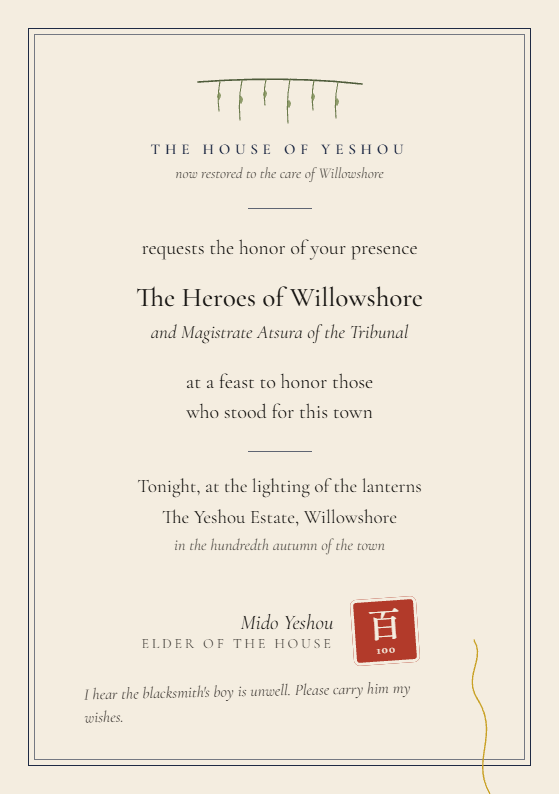
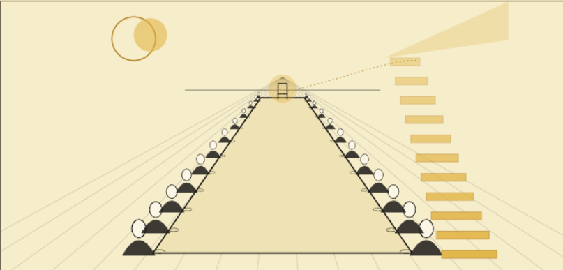
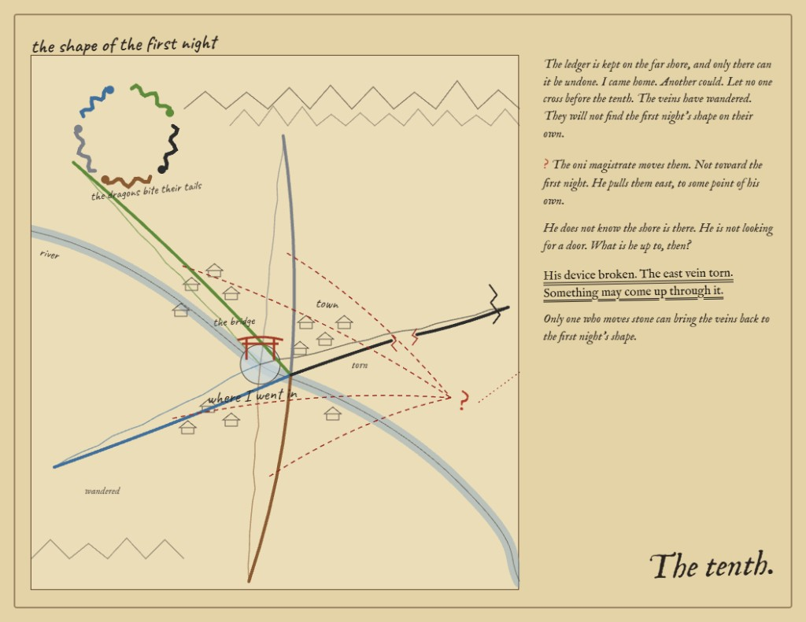
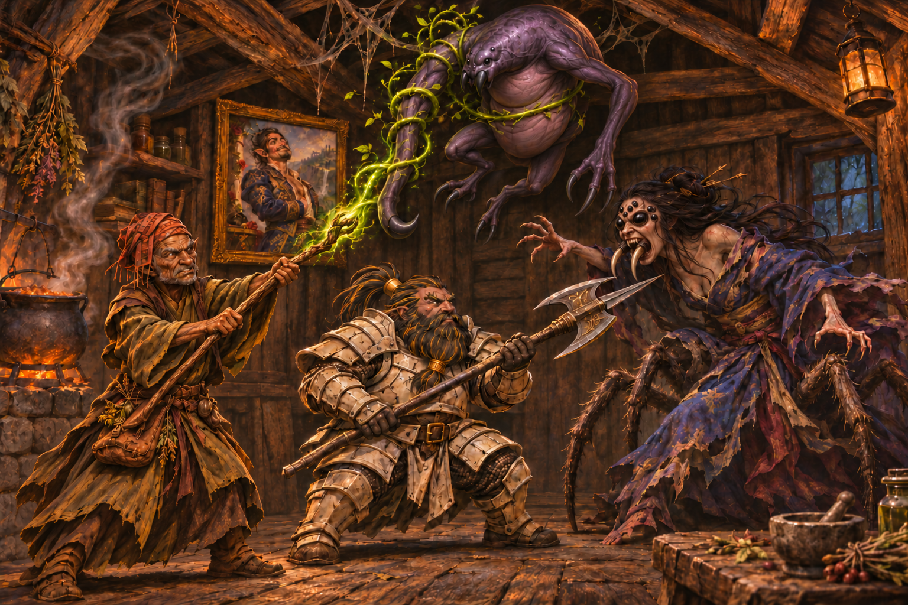

# Session Nineteen: The Count Comes Due

**Date:** November 12, 2026

*Chapter 19. In which a blacksmith's boy reaches for a judge who isn't there, a magistrate and an orc find a fresh tally and a little chair waiting, a woman cooking stew in a halfling cabin turns out to have too many legs, a drunk mayor walks into a rumor, and the Yeshou toast their heroes while a thief rolls up the chart that was never meant to leave the frame upstairs.*

*(Note: David was out; Gary ran Donkey at level 4. The party is level 5.)*

---

## Overview

Morning of Day 6. [Hong](../wiki/npcs/hong.md) was feverish and marked, mustard moth-dust under his nails, whispering that Boone has a big chair and he has a little one: *"If it comes for me, tell Kimmy I was brave."* [Ginkgo](../wiki/pcs/ginkgo.md) judged the illness a **curse**, not a wound. While [Da Baishan](../wiki/pcs/da-baishan.md) and [Atsura](../wiki/npcs/atsura.md) searched [Cheng's](../wiki/npcs/the-smiling-one.md) old room — tally now **96**, fresh charcoal reading ***The little chair is ready*** — Boone and Donkey walked a disguised [Meilin](../wiki/npcs/meilin.md) south and found someone cooking in Littlefinger's cabin. She called herself **Okio**, spoke of the centennial, then dropped the darkness and showed her extra legs. Her husband, the **web lurker** who fled the party months ago, dropped from the rafters. They cut free and ran. That evening the [Yeshou](../wiki/factions/willowshore-ruling-family.md) hosted a feast. Boone saw a double vision of Carcosa's masked table. Masru stormed out after a "lead" on Meilin. Littlefinger and Atsura stole the **framed chart** from behind a tapestry upstairs — the first thing Kurosawa took from the family, and the first thing they demanded back.

---

## Key Events

### Level Five, Morning After

The party woke at level 5 (Donkey still 4; Gary will level him next time for third-level spells). Highlights:

- **Littlefinger**: climbing suite upgraded (Follow the Expert / Prepare a Route); **Step Lively**; sneak attack now **2d6**. Took Da Baishan's crossbow in trade (*"Next money I steal is yours"*)
- **Ginkgo**: Speak with Kindred (plants and fungi); considering a bonded skink
- **Da Baishan**: **Orc Ferocity**; intimidation up
- **Boone**: **Rock Runner**; fighter weapon mastery (polearm — critical shove); intimidation up

### Hong: The Little Chair

At [Yong's](../wiki/npcs/yong.md) modest hut by the forge, Hong was pale, clammy, feverish since returning from the festival. The mark was on his lower neck. Under his fingernails: **fine mustard moth powder** — the same ground carapace and wing-dust the party has seen across Willowshore (Ginkgo, Nature 16).

He reached a shaky hand out: *"Where's Boone? The judge, the dwarf?"*

> *"He has one too. It was big. Mine was small. But he has a chair. I saw his. If it comes for me, tell Kimmy I was brave and wasn't scared."*

Ginkgo went to heal him and critically read the symptoms first (Religion/Arcana 31): this is **not** physical damage. Ordinary healing won't touch it. **It's a curse.** Yong has no idea why a twelve-year-old would be cursed; he was going to ask [Old Amber](../wiki/npcs/old-amber.md). Littlefinger and Ginkgo stayed with father and son while Da Baishan left with Atsura.

### Across the Bridge: Masru and the Invitations

On the way to Cheng's old room at the Silver Mist, Da Baishan and Atsura crossed paths with **[Masru](../wiki/npcs/mayor-masru.md)** walking a loaded cart south. His formal sash was gone. He'd gotten out of his commission with the new leadership, and the Yeshou were moving back into their estate. He sneered about Littlefinger *"stealing more prized possessions,"* and made his position plain:

> *"Every little bird comes back to the nest. I'll find her before I leave... You can tell your friend Littlefinger that I haven't given up on it."*

Da Baishan: birds also leave the nest when they've outgrown it. Masru: *"We'll see, won't we?"* He took a room at the Silver Mist for a few more days.

A Yeshou retainer met them on the bridge and handed out sealed envelopes — one for each hero, one for Atsura, one for Masru:

**THE HOUSE OF YESHOU** *now restored to the care of Willowshore* requests the honor of **The Heroes of Willowshore** and Magistrate Atsura of the Tribunal at a feast tonight, at the lighting of the lanterns, the Yeshou Estate, *in the hundredth autumn of the town.* Signed **Mido Yeshou**, Elder of the House. A handwritten postscript: *"I hear the blacksmith's boy is unwell. Please carry him my wishes."*

Masru read his, smirked, and promised to attend: *"I'll see you tonight. And don't forget to tell your friend... I'm hoping by tomorrow I will have my prize."*

### Cheng's Room: 96 and Fresh Charcoal

Atsura had come for more than the writing. [Captain Akoto's](../wiki/npcs/captain-akoto.md) immaculate logs listed one item [Kurosawa](../wiki/npcs/magistrate-kurosawa.md) took from the Yeshou and that they demanded back first: a **framed chart / framed map**. She'd already searched the rooms they stayed in. She hoped it might be here.

Da Baishan (Perception 27) noticed what had changed:

- The wall tally that was **95** is now **96**
- New phrases had appeared (multiple languages, forward and backward), including writing Gary pasted in chat — the long form of the five roles and the King's ledger (see Discoveries)
- One line in **fresh charcoal**, still smudging on the fingers, written maybe half an hour before they walked in:

> ***The little chair is ready.***

Hong had said the same thing that morning. Atsura: *"This is definitely tying together. And I don't have a very positive feeling about the situation at all."* No chart in the room. They headed back to Yong's. The estate feast that night would get them upstairs.

### The Cabin: "Darling, It's Unlocked"

Boone, Donkey, and a disguised Meilin followed the ridge path south to Littlefinger's hunting cabin. Meilin, quiet on the walk: Masru never hit her. He had her pouring for the ceremony, called her his *prize*, his *investment*, looked at her like property. *"Some people can be very evil to things."*

Smoke rose from the chimney. Beef stew on the air. Boone snuck to a window (Perception 13): a woman maybe forty, long black hair, silk kimono, stooping over a halfling-height stove. Something shadowed in the rafters. Donkey knocked. From inside: ***"Darling, it's unlocked."***

She introduced herself as **Okio**. She and her husband had fled *"spidery type things"* in the hills, she said, taken refuge, would pay for supplies. They were travelers for the **centennial** — one hundred years since the elemental dragons formed a ring, a chance to stand near Willowshore's ley lines. Donkey's memory snagged: he was alive then. He vaguely recalls **the Night the River Sang**, and a **missing girl**. The memory feels suppressed, clouded.

Boone slipped in the window behind her (Stealth 27). Donkey asked her to leave. She turned, saw the dwarf, smiled: *"Should I be worried?"* Boone Intimidated (24): quit hiding whatever you're hiding.

She spoke a few phrases in a foreign tongue. The light went out.

### Spider Fight

Darkness filled the cabin — a sphere that snuffed lanterns and daylight. Boone's darkvision worked at dim; Donkey was blind. Initiative: Boone 30.

**Okio** shed the kimono's lie: extra legs unfolded from under the robe. She taunted the blind wizard. Boone stepped between her and Donkey, hit for 15, missed the second swing. She bit him (28) for 16 plus poison (Fort 15 failed — pus at the wound). Donkey's Ignition streaked and was smothered by the dark. Boone hit again for 16 and sheared through one of her legs; she screamed: ***"Darling, it's time for you to join us."***

From the rafters: the **web lurker** who fled the party in the hills months ago, sickle-claws like velociraptor toes. Donkey landed a **critical Tangle Vine** (30) and immobilized him. Boone battle-medicined, yelled retreat, and ran into daylight five feet past the door. Okio missed Donkey once; Donkey fled. The vines held the husband. At the doorway, darkness fading, missing a leg joint, she called after them:

> *"We will take this cabin, and our children will be stronger. You will see. You will see."*

Meilin was already hustling: *"I don't think I should stay there."*

### Reunion and a Rumor

Outside town the fleeing trio met Littlefinger, Ginkgo, Yong, and Hong heading south. Boone: *"Littlefinger, you got giant spiders there. We got to burn the place down."* — *"No follow-up questions. Agreed."*

Masru was hunting Meilin in town. The cabin was compromised. Plan: hole up at [Willow's](../wiki/npcs/radiant-willow.md) (Akoto had already searched it once); Da Baishan would "gather things" at the inn, bump Masru, and **Sow Rumor** that Littlefinger had taken Meilin to the cabin — alone — during dinner, while promising Masru that Littlefinger would attend the full feast.

At the Silver Mist, Masru was already deep into dates and wine: *"Where's your cowardly friend?"* Da Baishan swore Littlefinger would be there the entire dinner. Secret Deception (+13) planted the cabin rumor among townsfolk and the inn. Critical-success territory on the rumor rules: it would stick. The trap was set — if Masru ducked out early, he'd walk into Okio's nest in the dark.

Afternoon: treat wounds to full (spell slots not recovered), Littlefinger poisoned his new crossbow bolts, shopping run — short bow, arrows, and bolts for **3 gp** after Da Baishan's Diplomacy 22 (*"hero's discount"*). Willow: *"Things grow better with company."*

### The Feast

Lanterns along the estate walk. Mido at the head of the table with Cheng, Emiko, Koji, and Hana. Masru already shining from a day's drinking. Atsura present. Toast:

> *"To the heroes of Willowshore and to this blacksmith's boy who is unwell tonight. May the river leave him and keep him safe."*

Ginkgo sat by Cheng. Boone sat by Masru (musical chairs so Littlefinger wouldn't have to). Cheng hummed under his breath, arranging chopsticks in a star pattern until Mido snapped *"manners"*:

> *"Willow and root and stone and rain, ash for the fifth and back again. Draw them crooked, draw them straight, the frame upstairs will make them wait."*

Boone went briefly comatose at the table — a **double vision** overlaid on the feast:

A long table vanishing into distance, rows of identical pale-masked figures facing inward, a little high-backed chair at the far end, a staircase of ten steps climbing into a pale ray. Scratching, as if someone were writing his name and role. He later asked the table about **Carcosa**.

Masru, drunk, turned to Boone about Meilin: the kind of vulnerable beauty you can't teach or buy, that made men want to protect her — *"It made me a fortune. I was this close."* Then, on Willow: artistic, paints up pretty, but *"who wants to be with a salad?"* He had a *"very strong lead"* and predicted she'd be back in his arms by morning. He shoved off Boone's shoulder, gestured at Littlefinger, and left for his *"critical"* matter. Mido stood until he was escorted out. Atsura slid into the empty space: *"Some folks just don't know when to quit... I'm sorry he was so ugly toward Willow."*

### Carcosa at the Table

Boone shared the vision. Perception checks around the table:

- **Littlefinger (30)**: Cheng bobbing, lips looping five times — ***"There's arms on the chair so you won't fall out"*** — while looking upstairs
- The other Yeshou children **recoiled** at pale masks and the long table
- **Mido's hand shook.** She glanced upstairs first, then answered: Carcosa was an old cult-of-the-tree / druid homeland, many years unspoken; the masks perhaps a druidic symbol
- **Littlefinger and Da Baishan** both read her: **deceptive.** Not the whole truth

Da Baishan pressed. Atsura, aloud, named the real errand: they were looking for a chart or tapestry upstairs — the item Kurosawa took, the first thing the family wanted back. She excused herself (*"food's been a little too rich"*) and Littlefinger followed in stealth, declining her invitation out loud then shadowing her anyway (*"this sounds like a trap all of a sudden"*).

### The Frame Upstairs

Behind an incomplete nature tapestry (fox, tree, nothing ominous) the frame stood proud of the wall. Inside: the chart. Atsura lit up. Littlefinger pulled it from its backing, rolled it into his document case, left the empty frame, and they slipped back down before dessert.

Walking home past the estate gates, Atsura translated what she could:

- The **ledger is kept on the far shore**, and only there can it be undone. *Let no one cross before the tenth.* The veins have wandered; they will not find the first night's shape on their own
- The **oni magistrate** (Kurosawa) moves them — **not** toward the first night. He pulls them **east**, to a point of his own. He does not know the shore is there. He is not looking for a door
- His device broken. The **east vein torn**. Something may come up through it
- ***Only one who moves stone can bring the veins back to the first night's shape.***
- Footer: **The tenth.**

The circle under the bridge is where the original lines met — *"where I went in."* The dragons bite their tails in the corner. The torn black line east is the rift from when the party removed Kurosawa's device. Whoever wrote the chart was watching him, and feared a return to the first night's shape — which is **not** what Kurosawa was doing.

Masru never reappeared. The rumor may have worked. Session ended on the bridge road south, chart in hand, more questions than answers.

---

## Memorable Moments

- **"Where's Boone? The judge, the dwarf?"** Hong, reaching with moth-dust under his nails
- **"Tell Kimmy I was brave."**
- **"Darling, it's unlocked."** — and then too many legs
- **Boone's Stealth 27** through a window behind a spider who thought she was alone with a polite elf
- **"Darling, it's time for you to join us."** Husband dropping from the rafters
- **Donkey's critical Tangle Vine** on the web lurker who got away last time
- **"The cabin's all yours."** Boone, over his shoulder, one of her legs left behind
- **"Littlefinger, you got giant spiders there. We got to burn the place down."** — *"No follow-up questions. Agreed."*
- **Musical chairs** so Littlefinger wouldn't have to sit next to Masru
- **"Who wants to be with a salad?"** Masru on Willow, then walking straight into a rumor
- **Cheng's chopsticks**, and the rhyme about the frame upstairs
- **"There's arms on the chair so you won't fall out."** Five times, looking up
- **Mido's hand shook** when Boone said Carcosa
- Littlefinger declining Atsura's invite, then following her anyway *"in case it's a trap"*
- **Hero's discount**: short bow, 20 arrows, 20 bolts, 3 gp

---

## Discoveries

### Lore Learned

#### The Count and the Chairs

Gary posted the fuller text that belongs with Cheng's walls and Hong's fever:

> *One hundred in a hundred years, five in every fifth year: the artist, the ruler, the sage, the lover, the judge.*
> *Their names are written in the King's ledger, kept in the King's own court across the lake.*
> *What is written in the King's hand is unwritten only by a judge who sits in the King's court. On the hundredth night, under the shape of the first night, the far shore lies down upon the near. Who would save the near shore must cross to the far. And smaller, over and over: the Night the River Sang.*

- Cheng's tally: **95 → 96**. Hong called himself **97** last session. The little chair is **ready**
- Boone's feast vision: a hundred places, pale masks, a little chair at the vanishing point, **ten steps** up. Cheng: arms on the chair so you won't fall out
- Hong's illness is a **curse**, not a disease. Moth powder under the nails. Ordinary healing fails the diagnosis before the spell is even spent

#### Cheng's Dinner Rhyme

> *Willow and root and stone and rain, ash for the fifth and back again. Draw them crooked, draw them straight, the frame upstairs will make them wait.*

The "frame upstairs" was literal: the chart behind the tapestry.

#### The Chart — Shape of the First Night

| Detail | Meaning (Atsura / table read) |
|---|---|
| Circle under the bridge | Original convergence; *"where I went in"* |
| Dragons biting tails | Centennial alignment |
| Colored veins | Ley lines; some labeled *wandered*, one east line **torn** |
| Torn east vein | The rift from removing Kurosawa's device |
| Red dashed geometry / **?** | Magistrate pulling lines east to a point of his own |
| Side text | Ledger on the far shore; do not cross before **the tenth**; only **one who moves stone** can restore the first night's shape |

#### The Night the River Sang

Donkey (level-4 memory, clouded): ~100 years ago, the day the river sang, and a **missing girl**. Okio claimed to be traveling for that same centennial spectacle. The invitation calls this *the hundredth autumn of the town*.

#### Carcosa and the Yeshou

- Atsura: the word appears in **Kurosawa's journals** — person, place, or ship, she wasn't sure
- Donkey's older Occultism: a place of an old cult, long believed dead — their hell or nirvana
- Mido's dinner answer was **a lie by subtraction**, again. Her children recoiled. Cheng already knew the chairs have arms

### Items and Resources

| Item | Holder | Detail |
|---|---|---|
| **Yeshou feast invitations** | Party + Atsura (+ Masru's) | Formal summons; Mido's PS about Hong |
| **The framed chart** | Littlefinger (document case) | Pulled from upstairs backing; empty frame left behind |
| **Da Baishan's crossbow** | Littlefinger | Traded; sneak-attack bolts prepared with daily poison |
| **Short bow + 20 arrows** | Da Baishan | 3 gp hero's discount bundle with bolts |
| **20 crossbow bolts** | Littlefinger | Same purchase |
| **Littlefinger's cabin** | Okio & web lurker | Compromised; *"our children will be stronger"* |

### Character Notes

- **Boone**: fought a spider-woman in magical darkness, poisoned, fled with Meilin; sat through Masru's worst speech; shared a Carcosa overlay with the table; asked Atsura about the name
- **Donkey** (GM-run): remembered the River Sang imperfectly; critical-immobilized the web lurker; still level 4
- **Da Baishan**: Cheng's room with Atsura; planted the cabin rumor; hero's-discount shopping; pressed Mido on Carcosa
- **Ginkgo**: diagnosed Hong's curse; sat by Cheng and caught the willow-and-root rhyme
- **Littlefinger**: stole the chart with Atsura; Meilin safe at Willow's again; new crossbow ready for dinner politics

---

## Open Threads

### Active Mysteries

- **What happens when the count hits 100?** Tally at 96; Hong is 97; chairs are being made ready. The hundredth night, under the first night's shape, the far shore lies down on the near
- **Can a judge unwrite the ledger?** Only a judge sitting in the King's own court across the lake. Boone is JUDGE on the near shore
- **Hong's curse.** Who marked him, what "comes for him," and can Old Amber or anyone else break it before the little chair is used?
- **Restore the veins, or leave them?** The chart-writer feared return to the first night. Kurosawa pulls east instead. The east vein is torn. *"Only one who moves stone..."*
- **What is Mido still subtracting about Carcosa?** Her hand shook. The tapestry of five moth-faces and the RECEIVED tablets are back under her roof
- **Okio's "children."** The cabin is a nest now. Masru may have walked into it
- **The tenth.** Do not cross before it. Boone's vision had ten stairs. The chart ends on the word

### Promises and Debts

- **Meilin** is at Willow's again, after the cabin failed. Masru believes (or will believe) she is alone at the cabin
- **Masru's commission** is void; he still wants his "prize" before Kirahata
- **The empty frame upstairs** will be noticed
- **Burn the cabin** is still on Littlefinger's to-do list

### Next Steps

1. **Study the chart** with Donkey's occultism and Da Baishan's Order eye — especially "one who moves stone" and the far-shore ledger
2. **Hong**: curse relief, protection, and what 97 means as the tally climbs
3. **Check whether Masru survived** his evening stroll to the cabin
4. **Mido**: press the Carcosa lie now that the chart is out of her house
5. **The torn east vein**: what is coming up through it?

---

## Timeline

| Time | Event |
|---|---|
| Day 6, morning | Level-ups. Party split: Boone/Donkey/Meilin south; others at Yong's with Hong |
| Day 6, morning | Hong's moth-dust, the chairs, *"tell Kimmy I was brave."* Curse diagnosis |
| Day 6, morning | Masru on the bridge: commission void, still hunting Meilin. **Yeshou invitations** |
| Day 6, morning | Cheng's room: tally **96**, ***The little chair is ready***, no chart |
| Day 6, late morning | **Okio** at the cabin; darkness; spider fight; web lurker; retreat |
| Day 6, midday | Reunion on the south road. Plan: Willow's + cabin rumor |
| Day 6, afternoon | Heal, shop, hide. Da Baishan sows the rumor at the Silver Mist |
| Day 6, evening | **Yeshou feast.** Cheng's rhyme. Boone's vision. Masru exits on a "lead" |
| Day 6, evening | Atsura + Littlefinger steal **the chart** from behind the upstairs tapestry |
| Day 6, night | Chart read on the walk home. **Session ends** |

---

## The Scene

### The Cabin Is Yours

The stew smelled honest. That was the first wrong thing. Beef and rice and something sweet underneath, drifting out of a chimney that should have been cold, through a clearing that should have been empty, into the noses of a dwarf, an elf, and a disguised gravekeeper who had already walked too far to turn around. Boone took the window. Inside: a woman of forty, long black hair, silk that did not belong on a ridge south of Willowshore, stooped over a stove built for someone half her height. Something bulked the rafters above her — tarp, netting, a shadow that might have been Littlefinger's idea of storage. Donkey knocked. From inside, warm and unsurprised: *"Darling, it's unlocked."* She called herself Okio. Travelers. Centennial. Ley lines. Spiders in the hills, she said, as if naming the thing made her less of it. Boone slid through the window behind her on a twenty-seven, boots soft among Littlefinger's chotchkes and the gold-framed painting of some smug blue-coated rake with lipstick still drying on his jaw. Donkey asked her to leave. She turned, saw the dwarf, smiled with too many teeth not yet showing, and asked if she should be worried. Boone's new intimidation landed like a hammer: quit hiding. She spoke three phrases in a tongue that did not belong to the stew, and the daylight died.

Darkness filled the cabin the way water fills a cup — lanterns snuffed, the open door a rumor, Donkey blind and Boone seeing only dim shapes with a -4 clinging to every glance. Extra legs unfolded from under the kimono. She taunted the wizard who could not see her. Boone stepped between them, polearm out, and put fifteen points of steel into whatever she was becoming. She bit him for sixteen and left poison bubbling at the wound like pale pus. His second wind came up temporary and angry. Donkey's Ignition streaked and was smothered, a flame drowned mid-air. Boone hit again, sixteen more, and sheared through a leg joint that clattered onto the floorboards beside a pot that was still politely simmering. She screamed for her husband. From the rafters, the web lurker who had fled them months ago in the hills dropped on sickle-claws, and Donkey — still half-blind, still level four, still somehow the oldest thing in the room — put a critical Tangle Vine into him that held like a promise. Boone yelled retreat, slapped a Battle Medicine bandage onto himself, and ran for the rectangle of daylight that was beginning to remember how to be a door.

She missed Donkey once on the way out. The vines held her darling. At the threshold, darkness thinning, one leg short and dignity shorter, Okio called after them that the cabin was theirs now, that their children would be stronger, that the trespassers would see. Meilin was already moving: *"I don't think I should stay there."* Behind them, steam still rose from a meal no one would eat, and on the wall Littlefinger's painted double kept grinning through the lipstick as if none of this were his problem. By the time they met the others on the south road, Boone had reduced the whole encounter to a single line that required no follow-up: *"Littlefinger, you got giant spiders there. We got to burn the place down."*
