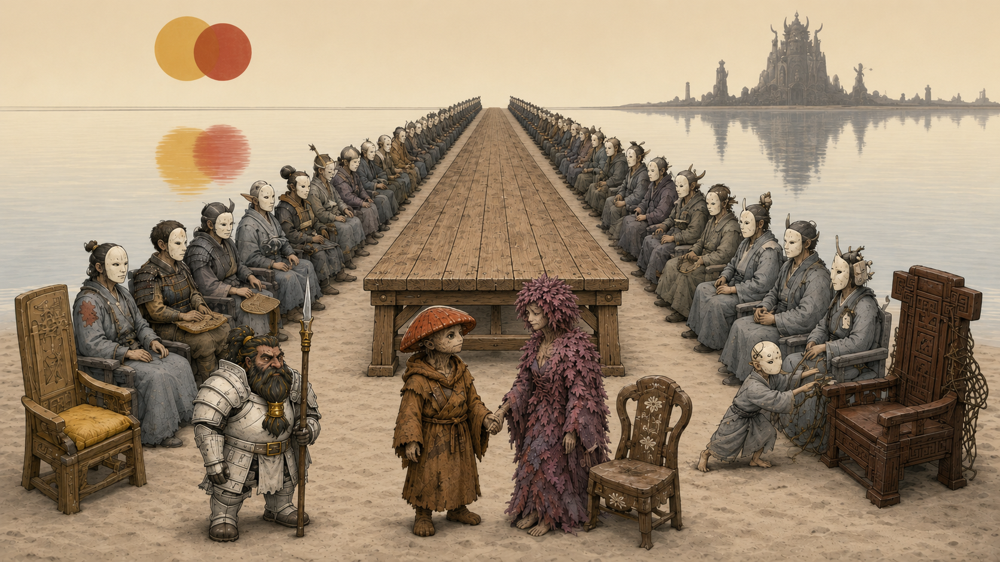

# Session Twenty: Young Love

**Date:** November 19, 2026

*Chapter 20. In which the road home from a feast becomes a grey shore with a hundred chairs, four devils step through a tear in the night, a blacksmith's boy is found soaked in lake water and not quite dead, a magistrate admits whose daughter she is, an old woman confesses to a hundred-year love affair, a river spirit hands out gifts for a journey it cannot follow, and the lines begin to move.*

---

## Overview

Walking south from the Yeshou feast, Boone and Ginkgo froze in place as [Willow's](../wiki/npcs/radiant-willow.md) vision pulled them onto the grey shore of [Carcosa](../wiki/locations/carcosa.md): a hundred masked figures at a long table, three empty chairs, and [Hong](../wiki/npcs/hong.md) being dragged toward the smallest one. Four devils tore through the thinning veil and died hard in the street. At the forge the party found Hong lying in lake water, his body dead and his spirit held somewhere short of the afterlife. That night [Atsura](../wiki/npcs/atsura.md) admitted she is [Kurosawa's](../wiki/npcs/magistrate-kurosawa.md) daughter and went to fetch him. In the morning [Mido](../wiki/npcs/mido.md) came to breakfast and confessed everything. She is the girl who walked into the river a hundred years ago. She met the King. The marks are her *"wedding gift."* In three days he comes for her, and Carcosa comes with him. Kurosawa agreed to pull the ley lines back to their first-night shape and open the door so the judge can cross. Boone and [Yong](../wiki/npcs/yong.md) rebuilt the fifth device, [Old Amber](../wiki/npcs/old-amber.md) gave out gifts for the far shore, and as the lines began to move, Mido came down on the bridge like a black bolt, screaming at them to stop.

---

## Key Events

### The Shore Between Steps

The feast ended around the fifth hour past sunset. On the walk south Ginkgo argued the whole party should spend the night at [Willow's](../wiki/npcs/radiant-willow.md) with Hong and Yong, since Willow and Hong are both marked and the [soul eater](../wiki/npcs/soul-eater.md) could come for either of them. Then the road disappeared.

Only **Boone and Ginkgo** saw it. The rest of the party watched them stop dead in the street, catatonic.

- **Grey sand** beside a lake of perfectly still water. **Two suns** hanging low, one behind the other. Towers piercing the horizon across the lake
- **A long table** running along the sand with about **a hundred chairs**. A grey-robed, pale-masked figure sat at every place **except three**
- A small figure, about three feet tall, walked up to **a smaller chair** on the far side of the table

Ginkgo felt something take his hand. **Willow** was beside him, her petals dimmer than he'd ever seen them. It was her vision; the mycelial bond had carried him into it with her.

> *"Ginkgo, that one's mine, isn't it? Someone made it very carefully. Like they've been waiting for me for a long time. I don't want to sit in it. I'm afraid what will happen if I do."*

The small masked figure turned toward them and spoke in **Hong's voice**, trembling, resisting something that pulled him toward the chair: *"...you can save us all on this shore. Enter the door."* He was nearly in it. His last words before the vision broke: *"No, Kimmy, it wasn't her fault."*

The town came back: lights, the bridge ahead, four friends standing over two statues. Then a **tearing sound**, and four creatures stepped out of a hidden rift onto the road.

### Devils on the Bridge Road

Da Baishan's **Arcana 29** explained the rift. The two shores are drawing closer by the hour, the veil is thinning, and things are starting to tear through the gaps. These were soldiers from another plane (demons or devils, depending on who's naming them), **immune to fire** and **resistant to physical weapons** except silver or magic. Their hoofprints left little patches of flame. They carried barbed, razor-like blades and howled in something guttural and infernal. Littlefinger, before initiative: *"Don't judge a book by its cover. They could be traders come to see about picking up new spices."* Da Baishan, afterward: *"So they're probably not traders looking for pottery, then."*

Boone: *"Are demons alive?"* Ginkgo: *"Only one way to find out."*

**Round one.** Ginkgo opened with **Vitality Lash** (13; they weren't especially vulnerable to it) and set a **Forbidding Ward** on Boone, +1 to AC and saves. At the table it became a **mushroom stamp on Boone's forehead**. All four devils charged Boone and **all four missed**. Boone missed once, then hit for 11 and 17, leaving the wounded one barely standing. Littlefinger, debuting his crossbow **Crossy McBowface** with pre-poisoned bolts, put a bolt in its heart for the kill. It burst into flame and singed Boone (*"As a forged dwarf, I only take two"*). Littlefinger reloaded and hid (Stealth 31, *"hide and seek champion of the world"*). Donkey's **Sleep** dropped two of the remaining three. Da Baishan missed twice.

**Round two.** Ginkgo lashed the one still awake (9) and sustained the ward. That devil hit Boone for 12, then **kicked its sleeping buddy awake**. Da Baishan: *"That's not very sporting."* Boone **tripped** one (22) and hit another for 10. Littlefinger sneak-attacked the prone one from hiding for 10, then missed and yelled to Da Baishan, *"You're right, something's wrong with this crossbow."* (*"I've been telling you guys that this whole campaign."*) Donkey's **Tangle Vine** slowed a third. Da Baishan's new **Divine Lance** missed, and so did both guandao swings. Then Ginkgo cast the same spell *"with a wink and a smile"*: **Divine Lance, natural 20, critical for 32**, and the devil was gone. The beam grazed Da Baishan on the way past, *"to enhance him with the power of friendship."* Da Baishan: *"How did you roll a 20 and then four fours on four d4s?"*

The last sleeper woke on its own. The prone one stood up into Boone's **reactive strike** (15) and slashed back for 13.

**Round three.** Boone took its head off (9 more). Fire spat out at him; he breathed it in, thought of his forge, and took one point. Gary: *"Feels like home."* Littlefinger ran up, knelt, and missed. In his head the crossbow is a Drizzt-style hand crossbow; on the table it's *"gangster sideways."* Donkey's **Hypnotize** bounced off (26). Da Baishan's Divine Lance finally landed (13, *"with an orcish aftertaste"*), then his guandao hit for 12. Ginkgo lashed it for 11. The last devil snarled two words at Boone, ***"Die, judge,"*** and swung twice. The first swing missed only because of the ward (*"the mushroom saves you"*). Boone's third swing (23 for 14) killed it. One more point of fire. Rosy cheeks.

### The Boy in the Wet Bed

Around 10 PM the party went to Yong's hut by the forge. Yong met them at the door with a forge mallet in hand. He'd heard the fighting and was coming to help. Boone: *"We've come to help. We're gonna gather in one place, and we're gonna protect everybody against these dark forces."* Yong said Hong had been restless but had gone quiet. He thought that was a good sign.

Everyone rolled high on Perception (22, 24, 32). Hong lay on his side in the cot, **not breathing**. His sheets and pillow were soaked dark, not with blood but with **water that smelled of salt**, the same smell as the still lake in the vision. His hair was matted as if he'd been lifted out of a bath and laid down. His skin was very pale, and **his mark had changed**. Where Boone's is a three-pronged swirl, Hong's was now a **pale mask** in white ink.

Ginkgo's **Religion** (14): Hong is dead but not dead. His body is here and physically dead, but his spirit hasn't passed into the afterlife. Something is holding him in between.

Yong saw the water and dropped to his knees. *"Hong, my son."* He held his son's head and shook. *"I did everything. It wasn't your fault. It wasn't your fault."* Boone: *"Yong. We're going to help him. It's not over yet."* Da Baishan: *"There's something here."*

> *"If there's anything — if I could be any assistance — I don't have the arcane skills, the martial prowess of anybody here, but I will do everything and anything to get my son back. If it's money, skills, extra hands, I will do what I can."*

They brought Hong with them. Yong wrapped him in a blanket and carried him himself, staggering under the dead weight, and waved off every offer to help.

### Willow's, Near Midnight

A single lantern burned at [Dew Drop Petals](../wiki/npcs/radiant-willow.md). [Meilin](../wiki/npcs/meilin.md) was in the front room consoling Willow after *"another very dire dream."* Willow took Ginkgo's right hand in both of hers:

> *"I know you saw. I know you were there, and I thank you for being there with me. It gave me some comfort. I don't know when they'll come for me, but it was good to see a friend while I was over there."*

When Yong came in with Hong in his arms, Willow and Meilin put their hands on him and said a few words about a good, hard-working kid, about his love for [Kimmy](../wiki/npcs/kimmy.md), and about the two of them never getting to grow up together.

### The Chart, Read Properly

With Atsura in the salon, the party went back over the chart and Cheng's walls.

**Donkey (Willowshore Lore 25)**: the Night the River Sang is no urban legend. About a hundred years ago **a little girl disappeared into the river at the bend by the bridge**. Donkey is now convinced he was there and saw it. Something is clouding what came after.

**The ley lines** (the group's Occultism, and Gary's explanation of the chart):

- The ley lines **drift** over the years, like constellations. For a century they've been drifting **east**
- A hundred years ago, on the day the river sang, the elemental dragons lined up head to tail in a ring and **the door opened**. That alignment comes again **in about three days**
- To open the door, the lines have to be **back where they were a hundred years ago**, not where they are now
- The dotted lines on the chart are Kurosawa pulling them east, **not** toward the door. Whoever annotated the chart feared he'd pull them back to the first night's shape
- *"Only one who moves stone"* means a **geomancer**

Ginkgo: *"Sounds to me like we need to find Kurosawa and persuade him."* Da Baishan: *"One way or another."* Ginkgo also pointed out that the judge can unwrite the ledger only from across the lake.

### "He'll Heed the Call of His Daughter"

Then Atsura said she could reach Kurosawa:

> *"He may not answer to a magistrate, but I believe that he'll heed the call of his daughter."*

Boone: *"What? You're holding out on us."* The hints were all there in hindsight: the lecturing father who cites oni precedent, *"You've been taught well"* at the sentencing. Gary admitted he'd been trying to keep it secret for a while, but Claude picked it up in the session summaries about four sessions back.

> *"Yes, he is my father. I believe he'll come. I'll bring him here, to Dew Drop Petals. We need to keep him safe, but we need his skills to move these lines."*

Will he cooperate? She hopes so. He's marked, so it's in his interest. By the party's count, **Boone, Willow, and Kurosawa** are the last three marked. She is no geomancer herself. She nudged Da Baishan: *"I would think someone of the Order might have picked up on this, but I'm closer to an investigator, like Da Baishan here."* Da Baishan: *"Oh. I've certainly picked up a few things."* She put on her cloak and went out into the dark.

Donkey asked who else in town is old enough to remember the Night the River Sang. Only one person: **Cheng's mother**. Littlefinger wanted to go shake her down. Da Baishan: *"You just want to yell at the old lady and pickpocket her again."* — *"I want to make sure that the team has the resources required to accomplish their mission."* Donkey: *"If those resources are scones, then they're scones."*

The party slept at Willow's, healed fully, and got their spell slots back.

### Breakfast with Mido

Morning of Day 7. Willow was humming and setting out fruit, dates, nuts, and herbal tea. The door bell rang. Instead of Atsura it was **Mido**, on a cane, calmer and happier than they'd ever seen her. **Cheng** followed with an even bigger smile, waved **three fingers** at the group, and perched on the back of a chair.

> *"Friends. We're coming up on the Centennial. A hundred years or so, and we're three days away."*

To Littlefinger: they haven't been on the best of terms, and *"a map of mine has been taken."* Then: *"Keep it. I don't really need it anymore. There's not much you can do with it anyway. I've had a hundred years or so to memorize it."* To Ginkgo and Willow:

> *"I can tell there's some affection there. A strong love, a true love. If you can wait a hundred years for your loved one, that shows something. That two parties separated across an expansive shore can still be together and still have this love... A hundred. That should mean something. That's a very special number."*

Da Baishan asked the obvious question: was she the little girl? Donkey's Society (14): she's about the right age, somewhere around 112 to 116. Out of character the table got uneasy (*"Why does she sound evil all of a sudden?"*). Ginkgo: *"She's definitely trying to manipulate us."*

> *"It's a day that I am looking forward to. Something that a little girl dreams about and thinks about what it'll be like on that day. And my day has come."*

Donkey asked her outright what really happened. She sat down, Cheng shuffled in beside her, and she told them:

> *"The song was beautiful. It's the song I know I'll hear on my wedding day. Donkey, you were there. I think I saw you up on the bridge. It was a cool day. But the enchanting music that came from the river that day... I could not step away. And had I not walked in, I don't think I would have met the people I met."*

Boone: *"Who did you meet?"* She smiled like a girl with a crush:

> ***"I met the King. And the King met me. And he saw me. And we will be together, finally."***

What followed was a confession:

- **The King is coming here.** In three days, at the centennial, he arrives, and Carcosa comes with him
- **The marked go to him**: *"That is for the King to take you, like he has taken all the others."* (Littlefinger: *"Sounds like you get a trip to Memphis."*)
- She waited. He made her wait. Then he *"gave me the signs of who are the five to be chosen."* Time runs roughly tenfold over there: *"It's been like 10,000 years that he has waited for me. That love is unshakable."*
- **Is the King Cheng's father?** *"No, no. Not yet. We will make a family soon, though."*
- **Did she place the marks?** Not by her own hand, but *"I had to make the prophecy come true when it was shown to me."* So she placed the curse. ***"Curse is such a harsh word. It's a wedding gift."***
- Da Baishan: *"You may not live to be a hundred."* — *"There's nothing you can do to me. My story has already been written. You've all played your parts, and you've done very well."*

**Boone grappled her** and pinned her into her chair. She laughed: *"Boone, what are you doing?"* — *"That boy is dying."* — *"He's already been claimed by the King. And believe your number is next."* — *"How can I go where he is?"* — *"The door is closed. There's no way to get back."* Ginkgo: *"We will open the door."* — *"I guess spend your days trying."*

Ginkgo cast **Command**. She rolled a **39** on her Will save. Da Baishan drew his guandao and held it to **Cheng's throat**: if she won't talk to save her own life, maybe she'll talk to save his. She looked at him almost kindly:

> *"Dear Da Baishan. You do not have a mark. You are not claimed by my King. Please do not anger me, because you have no protections on you like the others."*

She pushed up against Boone's grapple with a strength no frail old woman should have (Athletics 28 against his 31). He held her. *"The judge is strong. I will give him that."* — *"Thank you."*

> *"My King will join me on the third day. It is inevitable now. The prophecy has been fulfilled. The hundred have been claimed, or will be claimed. The door cannot be opened. Take these last three days and enjoy your friendship, enjoy your families, enjoy your loved ones. For it will be my King's arrival when the centennial hits."*

Ginkgo: *"You will answer for your sins."* Boone, realizing she was too strong to hold, let her walk to the door. She turned back once more:

> *"There's no sins. There's no crimes committed. I've just followed my heart. Just as you would have done, if any of you were in my position."*

The bell tinkled. Cheng bounced out after her, holding **three fingers** up at them from the doorway.

Da Baishan did the math: the tally in Cheng's room was 96 yesterday, so it's 97 today, which is Hong. Littlefinger finished it: *"That's Willow, that's Boone, and that's Kurosawa. 98, 99, and 100."*

### Kurosawa at the Salon

About ninety minutes later Atsura came back, not looking proud or happy. Behind her, a big cloaked figure pulled back his hood. It was **Kurosawa**. He pointed to his own mark:

> *"Looks like many of us share a similar fate. I'm sure you've all had restless nights, such as I have, about the lake and the land of the two suns. It seems that we have a shared destiny. And also, perhaps, a way out."*

He held up **a mirror**. His own reflection, Boone's, and Willow's all wore **pale masks** over their faces, though the people themselves didn't. Hong's body showed nothing.

He'll move the lines, but he needs the device the party pulled out at the Gosembiki. Da Baishan: *"Someone did."* Ginkgo: *"We reconfigured."* Boone: *"To be fair, there was a lot going on."* Donkey: *"Are you really going to keep bringing that up?"* **Four of his five devices are still in place.** The fifth has to be rebuilt to the original dimensions exactly and set on the eastern line, on this side of the break. That's enough to bend it back without repairing the tear.

What Kurosawa knows:

- **Everyone can cross** once the door is open. Mido did it a hundred years ago, and the veil is thinner now
- **The margin notes on the chart weren't there when he studied it.** They're in **Mido's handwriting**. *"Let no one cross before the tenth"* is her warning, meant to keep people from crossing before the hundredth day. **The party doesn't need to wait**
- **Her bargain needs a hundred souls by midnight of the hundredth day.** It's taking about one a day now. If even **one claimed soul is brought back** (Hong, say), she falls short and the bargain fails. A judge sitting in the King's court can take a name off the ledger
- There's **no shortcut through sleep** this time. They have to physically go to Carcosa, the other shore, *"like the Upside Down,"* and bring at least one person back. Hong is almost certainly sitting in his chair at the table
- If they do nothing, Carcosa merges with this world: *"There won't be a Willowshore."*

Kurosawa stayed hidden at Dew Drop Petals, since he doesn't think the town would welcome him. **Masru hasn't come back** since leaving the feast for the cabin, and nobody knows what happened to him.

### The Montage

Boone and Yong went to the forge (Athletics 17; Yong rolled a 20). Yong worked faster than they'd ever seen, taking exact measurements and having Boone quench pieces before assembly. What took shape was the **lantern-like spiral device** from the very first sessions. Gary narrated it as a movie montage with background music, Boone's muscles oiled and glistening like *"a three-foot-five Arnold Schwarzenegger."* Yong thinks it may be some of his best work. Within a few hours it was cooling, and then it was carried east toward the [Gosembiki](../wiki/locations/gosembiki-ruins.md) and set on the eastern line.

### Gifts from the River

The rest of the party went down to the river to ask [Old Amber](../wiki/npcs/old-amber.md) for help. Ginkgo led the offering ritual (**Religion 29**). The current slowed unnaturally and the water darkened. A golden glow rose from impossibly deep in a river only four or five feet deep, and golden scales broke the surface.

> *"Dear friends, it's good to see you. What is it you require of me?"*

Ginkgo: *"We are planning to travel to Carcosa. We need your blessing and help."* — *"You're going to the other shore, like the girl."* — *"We have to."* Da Baishan: *"Otherwise Carcosa comes to us."*

> *"It is as I feared for these many years. It's finally come. I can offer only help on this shore. I can give you gifts to assist you in the other. But I have no reach beyond here."*

A lily floated down and unfurled, carrying a gift for each of them:

| Recipient | Gift | Detail |
|---|---|---|
| **Boone** (at the forge) | **Ghost touch rune** on his polearm | It glowed on his weapon from across town. Strikes incorporeal creatures. *"The river weighs everything. Even judges."* |
| **Ginkgo** | **Greater staff of healing** | Driftwood. Bonus to healing; holds daily spells |
| **Da Baishan** | **Clandestine cloak** | Green reeds that never rustle. +1 Stealth, better at impersonating forgettable background people. *"Be the fog. The fog sees everything, and nothing sees the fog."* |
| **Littlefinger** | **Silver dagger** with a **rune of earthbinding** | Hurts creatures weak to silver (werewolves, demons, devils); thrown, it pins flyers to the ground |
| **Donkey** | **Wand of widening** (3rd level) | Forked river-reed. Widens the area or range of a spell of 3rd level or lower |

> *"I wish I could provide more. It's all I could do from here."*

The koi's tail slipped under, and the river picked its pace back up.

### The Lines Begin to Move

Boone and Yong came back down to the bank with the device placed. With them came Atsura and a large cloaked figure stooping to look smaller. Kurosawa walked to the water's edge:

> *"Well, I'm not sure if I should say friends —"* (Da Baishan: *"No, you should."*) *"— fellow heroes. I should call myself a hero. In this moment, we are ready to open the door."*

He etched lines in the air and pulled on something nobody else could see, chanting, like a tug-of-war against the inertia of the world. Now and then the air shimmered. The river and the earth groaned as he took a few slow steps backward.

Then a scream from the sky: ***"No! Get away!"*** A **bolt of black** streaked down and hit the bridge. When it cleared, **Mido** was standing there, frail and furious.

> ***"Leave the lines alone. You will not open this door."***

She swirled her hands, and **two giant creatures** rose up beside her. Session ended there, with combat to open next time.

---

## Memorable Moments

- **"Ginkgo, that one's mine, isn't it?"** Willow, holding his hand on the far shore
- **"No, Kimmy, it wasn't her fault."** Hong, almost in the little chair
- **"Don't judge a book by its cover."** Littlefinger, defending four fire-hoofed devils as possible spice traders
- **Crossy McBowface**: one kill, then two misses, and an apology to Da Baishan about the crossbow
- **The mushroom stamp.** Ginkgo's Forbidding Ward, design credit Da Baishan, and the reason "Die, judge" missed
- **Ginkgo's Divine Lance**, natural 20, four fours, 32 damage, delivered with a wink right after Da Baishan whiffed with the same spell
- **"Feels like home."** Boone breathing in devil-fire
- **"I did everything. It wasn't your fault."** Yong on his knees by the wet bed, then carrying his son across the square alone
- **"He'll heed the call of his daughter."** And Boone's *"What?"*
- **"If those resources are scones, then they're scones."**
- **"I met the King. And the King met me."**
- **"Curse is such a harsh word. It's a wedding gift."**
- **Command vs. a Will save of 39**
- **"The judge is strong. I will give him that."** — *"Thank you."*
- **Three fingers** from Cheng in the doorway
- **The mirror**: three pale masks in the glass
- **"We reconfigured."** — *"Are you really going to keep bringing that up?"*
- **The forge montage**, starring a three-foot-five Arnold Schwarzenegger
- **"Be the fog."** Old Amber's gift to the party's investigator
- **"Fellow heroes. I should call myself a hero."** Kurosawa, at the riverbank
- **A black bolt on the bridge.** *"You will not open this door."*

---

## Discoveries

### Lore Learned

#### Mido Is the Girl Who Went into the River

- About a hundred years ago, on **the Night the River Sang**, a girl followed the river's song in at the bend by the bridge. Donkey was there, up on the bridge. **That girl was Mido**
- Across the water she **met the King**. She has waited a century for him (*"10,000 years"* on his side, with time running tenfold), and he's waited for her. In three days they'll be *"together finally"*
- He *"gave her the signs"* of the five to be chosen, and she *"made the prophecy come true."* The marks are her doing: ***"a wedding gift"***
- She **wrote the margin notes on the chart** (*"let no one cross before the tenth"*)
- She has **powers she's been hiding**: a Will save of 39, strength enough to strain against Boone, flight as a black bolt, and the ability to summon giant creatures. She warned Da Baishan that the unmarked have *"no protections"* from her
- *"Lies by subtraction"* has been answered. The road she hid is the one she took herself. *"What followed the last traveler home"* was the King's claim

#### The Ledger, the Hundred, and the Door

- **A hundred souls in a hundred years**, and the last few are being claimed about **one a day**. The tally is at **97** with Hong. The party reads **98, 99, and 100** as **Willow, Boone, and Kurosawa**. Cheng held up three fingers
- **If even one claimed soul comes back across** before midnight on the hundredth day, the bargain is short and Mido's wedding fails, as far as anyone knows
- **The door** opens only when the ley lines are back in their first-night shape under the dragon alignment. Kurosawa can do that with **five devices**. Four are in place, and the fifth was just rebuilt
- **Everyone can cross**, not just the marked
- **If the party does nothing**, the King arrives and Carcosa lies down on Willowshore. *"There won't be a Willowshore"*

#### The Far Shore (Carcosa)

- A **long table** on grey sand by the still lake, **about a hundred chairs**, pale-masked figures in grey robes at every place **except three**. The claimed sit at the table, each in a chair with a role
- Hong's chair is **small**, and he was pulled toward it against his will. Willow's chair was *"made very carefully"*
- **The veil is thinning by the hour.** Devils from another plane are already tearing through

#### The Mark's Second Stage

- Hong's swirl turned into a **pale mask** in white ink when he died. His bed was soaked with **salty lake water**
- The living marked (Boone, Willow, Kurosawa) show **pale masks in their mirror reflections** but not on their faces

#### Atsura Is Kurosawa's Daughter

Confirmed by her, unprompted. Her lecturing father, the crane tattoo at nineteen, *"You've been taught well"* at his sentencing: all of it was him.

### Combat: Four Devils (Bridge Road, Night)

| Combatant | Notable |
|---|---|
| Ginkgo | Vitality Lash ×3 (13, 9, 11); Forbidding Ward on Boone; **Divine Lance crit for 32 (kill)** |
| Boone | Took nearly every attack. Trip, reactive strike, **two kills** (the second and the last). Fire resistance from his forge-dwarf heritage |
| Littlefinger | **First kill** with a poisoned bolt; Stealth 31; sneak attack for 10; two misses |
| Donkey | **Sleep** (two down), Tangle Vine, Hypnotize resisted |
| Da Baishan | Arcana 29 lore; Divine Lance 13 and guandao 12 on the last devil |

### Items and Resources

| Item | Holder | Detail |
|---|---|---|
| **The framed chart** | Littlefinger | Mido: *"Keep it."* The margin notes are in her hand |
| **Ghost touch rune** | Boone (polearm) | From Old Amber |
| **Greater staff of healing** | Ginkgo | Driftwood; from Old Amber |
| **Clandestine cloak** | Da Baishan | Silent reeds; from Old Amber |
| **Silver dagger of earthbinding** | Littlefinger | From Old Amber |
| **Wand of widening (3rd)** | Donkey | From Old Amber |
| **Fifth ley-line device** | Placed on the eastern line | Forged by Yong and Boone to the original's tolerances |
| **Hong's body** | With Yong, at Dew Drop Petals | Dead, but the spirit is held on the far shore |

### Character Notes

- **Boone**: tanked four devils and took two of them down; tried to hold Mido and couldn't; forged the fifth device with Yong; is the judge who has to cross
- **Ginkgo**: shared Willow's vision through the mycelium; warded Boone; crit the Divine Lance; diagnosed Hong as held between death and the afterlife; told Mido *"We will open the door"*; led the river ritual
- **Da Baishan**: Arcana on the veil; held a blade to Cheng's throat and got warned off by Mido; told Old Amber that otherwise Carcosa comes to them
- **Littlefinger**: first kill with Crossy McBowface; did the 98-99-100 math; got the chart handed to him to keep
- **Donkey**: back with David. Sleep, Tangle Vine; recalled the girl at the river bend; Mido says she saw him on the bridge a hundred years ago

---

## Open Threads

### Active Mysteries

- **Who are the King and Mido, really?** A hundred-year-old woman who flies, summons, and has a Will save of 39. The table's guess: the **King in Yellow**
- **Cheng.** *"Not yet. We will make a family soon."* Whose son is he, then? Why three fingers? And who wrote ***The little chair is ready***?
- **What will the two creatures on the bridge do**, and can Kurosawa keep pulling while the party fights?
- **Hong's last words**: *"No, Kimmy, it wasn't her fault."* Whose fault? Whose *her*?
- **Masru** never came back from the cabin. Okio's nest may have him
- **Does crossing require the marks?** Kurosawa says everyone can cross. Mido says the door can't be opened

### Promises and Debts

- **Yong**: *"I will do everything and anything to get my son back."* The party promised: *"It's not over yet"*
- **Willow**: her chair is waiting, and Ginkgo was there with her
- **Kurosawa and Atsura** are working with the party now. He called them *"fellow heroes"*
- **Burn the cabin** is still on the list

### Next Steps

1. **Survive Mido on the bridge** and protect Kurosawa while he works the lines
2. **Open the door** and cross to Carcosa with the judge
3. **Bring back at least one claimed soul**, Hong first, before midnight on the hundredth day
4. **Keep Willow, Boone, and Kurosawa alive and out of their chairs** for three more days
5. Find out what's left of Masru

---

## Timeline

| Time | Event |
|---|---|
| Day 6, ~10 PM | Walking south from the feast. **Willow's vision** pulls in Boone and Ginkgo: the table, a hundred chairs, Hong's little chair |
| Day 6, ~10 PM | **Four devils** tear through; killed on the bridge road |
| Day 6, ~10:15 PM | Yong's hut. **Hong found dead in lake water**; spirit held. Yong carries him to Willow's |
| Day 6, ~10:30–11 PM | Dew Drop Petals. Willow thanks Ginkgo. The chart explained. **Atsura: "his daughter."** She leaves for Kurosawa |
| Day 6, night | Long rest at Willow's |
| Day 7, morning | **Mido at breakfast**: the girl in the river, the King, *"a wedding gift."* Boone's grapple; Cheng's three fingers |
| Day 7, mid-morning | **Kurosawa arrives**. The mirror. The plan: the fifth device, the door, one soul back |
| Day 7, late morning–afternoon | Boone and Yong forge the device; it's set on the eastern line. The others go to **Old Amber** for gifts |
| Day 7, afternoon | Kurosawa starts pulling the lines. **Mido lands on the bridge** with two giant creatures. **Session ends** |
| Day 9–10 | **The centennial**: the King's arrival, the hundredth soul |

---

## The Scene

### That One's Mine

The lanterns of the Yeshou estate were still swinging behind them, and Ginkgo was halfway through his argument (Willow's place, all of us, tonight, because the thing that came for Boone won't stop at Boone) when the road stopped being there. He didn't step off it. It was just gone, and his next footfall landed on grey sand, fine and cold and soundless, beside a lake so still it looked poured and set. Two suns hung low over the far side, one behind the other, as if the second were hiding in the first, and between them a line of towers rose stark against a sky that gave nothing back. The air smelled faintly of salt. And along the shore, running farther than he could follow, was a table. A hundred chairs, near enough. At every one sat a figure in grey robes with a pale mask turned inward, motionless as the water. Every chair was filled except three.

Something touched his hand. He knew the touch before he looked: the quiet hum along the mycelial thread that ran between them, now pulled taut across a distance that wasn't measured in miles. Willow stood beside him on the sand, her fingers laced through his. Her petals had gone dim, the color washed out of them like a painting left too long in the window. She didn't look at him. She looked at one of the empty chairs, and when she spoke it was barely louder than the lake. *"Ginkgo, that one's mine, isn't it?"* The chair was beautiful. Someone had shaped every line of it with care. *"Someone made it very carefully. Like they've been waiting for me for a long time."* Her grip tightened. *"I don't want to sit in it. I'm afraid what will happen if I do."* He had no answer that was true, so he held on, and let the thread between them carry what he couldn't say: that he was here, and that she wasn't alone on this shore.

On the far side of the table a small figure walked up to a smaller chair. It came no higher than a child's shoulder, robed in grey and masked like the rest, and it was shaking. The mask turned toward them, and the voice that came from behind it was Hong's, thin and cracking, the voice of a boy fighting something much stronger than him. *"...you can save us all on this shore. Enter the door."* His heels dug furrows in the grey sand as he was pulled closer, one jerking inch at a time, his small hands braced against nothing. He was almost in it. *"No, Kimmy,"* he said, to someone who wasn't there, *"it wasn't her fault."* Then the shore went out like a snuffed wick. Ginkgo's hand was empty. Lantern light, the dark shape of the bridge, four friends staring at him and Boone as if they'd been carved from wood. And somewhere up the road, under the ordinary night sky of Willowshore, came the long wet sound of something tearing open.
